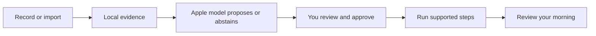

# MORE

**Less phone handling. More of the morning you enjoy.**

MORE — MOrning REcap — is an iPhone prototype that turns an explicitly shared glimpse of your morning into a routine you can review, adjust and run. Useful rituals—including messages, browsing and a game of chess—belong in the plan.

[V2 design](https://github.com/gibouu/morning-operator/blob/codex/more-quiet-morning/docs/V2-DESIGN.md) · [Get started](https://github.com/gibouu/morning-operator/blob/codex/more-quiet-morning/docs/ONBOARDING.md) · [Documentation](https://github.com/gibouu/morning-operator/blob/codex/more-quiet-morning/docs/README.md) · [Roadmap](https://github.com/gibouu/morning-operator/blob/codex/more-quiet-morning/docs/ROADMAP.md)



## Two tabs, a quieter morning

The development branch `codex/more-quiet-morning` introduces the V2 interface. It is **in progress and not yet installed on the owner's phone**. Review [PR #26](https://github.com/gibouu/morning-operator/pull/26), stacked on [PR #22](https://github.com/gibouu/morning-operator/pull/22). The source code on `main` remains the earlier scaffold; select the development branch when building the current iPhone app.

| Experience | V2 source behavior |
|---|---|
| Morning | A date, a compact routine and a clear start. Up to ten moments fit at default portrait size in the tested simulator; larger text and short layouts have a scrolling fallback. Pause and Stop remain reachable. |
| Review | Open a seven-day period and its days; revisit dated observations and their originals, edit and approve your routine, find saved thoughts, and open settings or connections. There is no separate Notes tab. |
| Review what was observed | Open sampled moments and their original text, correct one screen label or keep it unknown, and see which labels appeared on distinct days. Your labels stay separate from model proposals. Missing days, unresolved samples and different origins/time zones stay separate. [Observed mornings](https://github.com/gibouu/morning-operator/blob/codex/more-quiet-morning/docs/OBSERVED-MORNINGS.md). |
| Learn across mornings | Choose up to five dated observations in Review, inspect exact supporting quotations, and approve a separately saved update. Your current routine remains ready during this review. Explicit keep/exclude/timing choices survive later suggestions and can be cleared in Review. [Learning flow](https://github.com/gibouu/morning-operator/blob/codex/more-quiet-morning/docs/ROUTINE-LEARNING.md). |
| Show your morning | Explicit iOS 27 screen recording, or selected text/image/video import. Local extraction saves separate observations with original text and corrections; identical file imports keep the existing entry. Unknown recording dates stay explicit. Screen recognition and routine suggestions are separate explicit actions; suggestions stay pending until approval. Manual setup also works. |
| Prepare your day | Select calendars and an optional city in Review → Settings → Your day. One sourced recap supplies the visible text and speech; adding it to the routine creates a draft to approve. [Your day](https://github.com/gibouu/morning-operator/blob/codex/more-quiet-morning/docs/YOUR-DAY.md). |
| Hear a saved moment | Choose a dated excerpt in Review, hear its exact preview and add it to an unapproved draft. Source changes or deletion block replay. [Saved moments](https://github.com/gibouu/morning-operator/blob/codex/more-quiet-morning/docs/SAVED-MOMENTS.md). |
| Move through it | Supported spoken/calendar/briefing operations advance after completion. Other activities wait for you. A saved completed morning offers Speak, Write or Not now. |
| Begin with an invitation | Set one future notification in Review → Settings. Its tap or a foreground Start intent routes into an approved morning, waiting for a ready app. Physical delivery and Siri invocation remain unverified. [Morning entry](https://github.com/gibouu/morning-operator/blob/codex/more-quiet-morning/docs/MORNING-ENTRY.md). |
| Keep your place | Optional Lock Screen and Dynamic Island progress shows generic categories and passed moments. MORE pauses when you leave; tapping the activity reveals the same morning. Personal text stays in the app. [Lock Screen guide](https://github.com/gibouu/morning-operator/blob/codex/more-quiet-morning/docs/LIVE-ACTIVITY.md). |
| Speak a command | An explicit on-device English/French turn supports next, pause, resume, skip, repeat and stop. Entry/cancel behavior is tested; real microphone recognition remains a device check. [Voice guide](https://github.com/gibouu/morning-operator/blob/codex/more-quiet-morning/docs/VOICE.md). |
| Control what stays | Review → Settings → Privacy explains saved copies, disables activity logging and removes local data. Removal resumes after interruption; originals and Apple-app items remain separate. [Privacy guide](https://github.com/gibouu/morning-operator/blob/codex/more-quiet-morning/docs/PRIVACY.md). |
| Keep what matters | Speak one English/French reflection or write it, edit the words, then explicitly save. The completion invitation never starts the microphone. Review reminder/calendar requests before an optional save to the corresponding Apple app. This is bounded dictation, not an open conversation. |

Review measures **routine runs** and shows source-linked appearances in sampled observations. It does not yet measure complete phone usage or learned app habits. Optional configured Shortcuts log selected app entries/returns with incomplete coverage. [The design contract](https://github.com/gibouu/morning-operator/blob/codex/more-quiet-morning/docs/V2-DESIGN.md) explains the layout, native controls and metric boundaries.

## Where it stands

**Current V2 source: `c91f69e`.** Long saved observations now run in small sequential analysis requests with progress and cancellation, replacing the 8,000-character whole-input rejection. Review leads with observed mornings, opens day-by-day sampled sequences, and links a chosen original quote directly to an optional spoken preview. The compact Morning screen keeps its two-tab layout.

| Verified development behavior | Evidence |
|---|---|
| Long-input learning and evidence | **322 shared checks passed; 6 optional checks skipped.** A final **62-test** focused run passes after the request-wrapper correction. Covers long sources, Unicode, exact offsets, final-batch coverage, cancellation, late failure and rejection of the app's own overview as habit evidence. Model generation/accuracy was not tested. |
| Review navigation | Both corrected native simulator journeys pass: week → day → source → correction/relaunch, and exact quote → preview → explicitly added unapproved draft. Four existing review/home checks passed in the initial run. Initial failures and fixes remain in [verification](https://github.com/gibouu/morning-operator/blob/codex/more-quiet-morning/docs/PHASE-ONE.md). |
| Phone candidate | **Signed iPhone build succeeds**, signature and WeatherKit provisioning verified. The embedded Live Activity extension is present. It is ready for installation; the last device check found only the simulator. |
| Earlier native features | Saved-moment speech progression, fixture-video OCR/recovery, Calendar/Weather preparation, Live Activity, portable files and local forgetting retain separate scoped results in [verification](https://github.com/gibouu/morning-operator/blob/codex/more-quiet-morning/docs/PHASE-ONE.md). |

**Full-morning accuracy is still open.** The importer currently accepts up to 31 minutes and samples at most 24 screens with bounded OCR. Removing the text rejection does not measure every scroll, message read or time spent in apps. [Long-recording work #27](https://github.com/gibouu/morning-operator/issues/27) includes denser, resumable video ingestion. The Mac model still reports `modelNotReady`; skipped inference checks are not passes.

**Installed phone baseline: `8a640ea`.** V2 has not yet replaced it. The earlier short real recording reached saved OCR and a draft, but that draft mistook setup text for habits. Targeted guards address the known failure; physical recognition quality remains unproven.

The requested short opening, connected inbox counts, social-feed commands and subscription/research hypotheses are specified in the [product direction](https://github.com/gibouu/morning-operator/blob/codex/more-quiet-morning/docs/PRODUCT-DIRECTION.md). LEVE is a proposed name with existing App Store matches, not a completed rename. Real microphone/Siri, HomePod and listener-confirmed speech remain open. No issue is closed merely because its source compiles.

## Build on your iPhone

The app targets iOS 26 or later; native recording needs iOS 27. Use full Xcode on the development Mac, your own signing team and a paired phone. The observed physical setup is Xcode 27 with iOS 27.0.1.

```sh
./scripts/check-environment.sh
open MorningOperator.xcodeproj
```

Select the **MorningOperator** target and your phone, then build/run the intended branch. Shared package checks run on the Mac with `./scripts/test.sh`; add `--with-model` only when deliberately testing the available local model. See [onboarding](https://github.com/gibouu/morning-operator/blob/codex/more-quiet-morning/docs/ONBOARDING.md) for setup and [device checks](https://github.com/gibouu/morning-operator/blob/codex/more-quiet-morning/docs/DEVICE-SETUP.md) for reproducible verification. The [short morning trial checklist](https://github.com/gibouu/morning-operator/blob/codex/more-quiet-morning/docs/DEVICE-SETUP.md#tomorrow-morning-checklist) describes the installed baseline; use the V2 contract for this branch's navigation.

The iPhone is the sole active product. The Mac is the development/test machine and optional tethered controller; no separate Mac app is required. The repository, Xcode target and bundle identity retain Morning Operator naming.

## Your data and the model

Extraction and Foundation Models inference run locally. Optional city searches and current weather use Apple Maps and Apple Weather network services; only selected city/calendar settings persist, while recap facts stay in memory. There is no cloud-model fallback, model fine-tuning, billing or research-data upload pipeline. Saved routines, explicit routine choices, the observation archive with original/corrected text and ordered video samples, thoughts and local activity logs have different lifecycles; a finalized app-owned clip can remain for recovery until its extracted text is saved or the person discards it. Review [what is retained and what each clear control removes](https://github.com/gibouu/morning-operator/blob/codex/more-quiet-morning/docs/PRIVACY.md). Full forgetting removes the app-owned copies and leaves future activity logging off until explicitly enabled; automatic age-based expiry remains future work.

A later, separately opted-in mobile-agent research dataset is a [feasibility question](https://github.com/gibouu/morning-operator/issues/24), not current collection behavior.

## Explore the project

| Read | For |
|---|---|
| [Documentation hub](https://github.com/gibouu/morning-operator/blob/codex/more-quiet-morning/docs/README.md) | Find the right guide quickly |
| [V2 design contract](https://github.com/gibouu/morning-operator/blob/codex/more-quiet-morning/docs/V2-DESIGN.md) | Morning/Review, completion capture, native glass and honest metrics |
| [Your day](https://github.com/gibouu/morning-operator/blob/codex/more-quiet-morning/docs/YOUR-DAY.md) | Calendar/city selection, prepared speech, freshness and source privacy |
| [Saved moments](https://github.com/gibouu/morning-operator/blob/codex/more-quiet-morning/docs/SAVED-MOMENTS.md) | Exact historical excerpts, native speech, approval and changed-source refusal |
| [Morning entry](https://github.com/gibouu/morning-operator/blob/codex/more-quiet-morning/docs/MORNING-ENTRY.md) | One-time invitations, foreground Start, permissions and delayed-entry fallback |
| [Architecture](https://github.com/gibouu/morning-operator/blob/codex/more-quiet-morning/docs/ARCHITECTURE.md) | Components, states, data flows, model boundaries and Apple integrations |
| [Recording benchmark](https://github.com/gibouu/morning-operator/blob/codex/more-quiet-morning/docs/OBSERVATION-BENCHMARK.md) | Reproduce the controlled cross-app capture and inspect its measured limits |
| [Routine learning](https://github.com/gibouu/morning-operator/blob/codex/more-quiet-morning/docs/ROUTINE-LEARNING.md) | Saved mornings, exact quotations, pending proposals and approval |
| [Privacy & local data](https://github.com/gibouu/morning-operator/blob/codex/more-quiet-morning/docs/PRIVACY.md) | Inventory, full forget, recovery, external copies and unfinished expiry work |
| [Routine files](https://github.com/gibouu/morning-operator/blob/codex/more-quiet-morning/docs/ROUTINE-FILES.md) | Review a portable plan before saving or importing it; notes stay out by default |
| [Observation plan](https://github.com/gibouu/morning-operator/blob/codex/more-quiet-morning/docs/OBSERVATION-PLAN.md) | Consent, evidence, cycles, unknowns and multi-day learning |
| [Verified phone results](https://github.com/gibouu/morning-operator/blob/codex/more-quiet-morning/docs/PHASE-ONE.md) | Actual physical device/build/test evidence and open checks |
| [Roadmap and issues](https://github.com/gibouu/morning-operator/blob/codex/more-quiet-morning/docs/ROADMAP.md) | The next product slices and collaboration plan |
