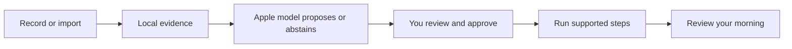

# MORE

**Less phone handling. More of the morning you enjoy.**

MORE — MOrning REcap — is an iPhone prototype that turns an explicitly shared glimpse of your morning into a routine you can review, adjust and run. Useful rituals—including messages, browsing and a game of chess—belong in the plan.

[V2 design](docs/V2-DESIGN.md) · [Get started](docs/ONBOARDING.md) · [Documentation](docs/README.md) · [Roadmap](docs/ROADMAP.md)



## Two tabs, a quieter morning

This branch, `codex/more-quiet-morning`, introduces the V2 interface. It is **in progress and not yet installed on the owner's phone**.

| Experience | V2 source behavior |
|---|---|
| Morning | A date, a compact routine and a clear start. Up to ten moments fit at default portrait size in the tested simulator; larger text and short layouts have a scrolling fallback. Pause and Stop remain reachable. |
| Review | Open a seven-day period and its days; revisit dated observations and their originals, edit and approve your routine, find saved thoughts, and open settings or connections. There is no separate Notes tab. |
| Learn across mornings | Choose up to five dated observations in Review, inspect exact supporting quotations, and approve a separately saved update. Your current routine remains ready during this review. [Learning flow](docs/ROUTINE-LEARNING.md). |
| Show your morning | Explicit iOS 27 screen recording, or selected text/image/video import. Local extraction saves separate observations with original text and corrections; identical file imports keep the existing entry. Unknown recording dates stay explicit. Screen recognition and routine suggestions are separate explicit actions; suggestions stay pending until approval. Manual setup also works. |
| Move through it | Supported spoken/calendar operations advance after completion. Other activities wait for you. A completion invitation opens capture; it is not yet a live spoken conversation. |
| Begin with an invitation | Set one future notification in Review → Settings. Its tap or a foreground Start intent routes into an approved morning, waiting for a ready app. Physical delivery and Siri invocation remain unverified. [Morning entry](docs/MORNING-ENTRY.md). |
| Speak a command | An explicit on-device English/French turn supports next, pause, resume, skip, repeat and stop. Entry/cancel behavior is tested; real microphone recognition remains a device check. [Voice guide](docs/VOICE.md). |
| Keep what matters | Save local dreams and thoughts. Review reminder/calendar requests before an optional save to the corresponding Apple app. Preserve the rituals you want when shaping a routine. |

Review currently measures **routine runs**, not complete phone usage or learned app habits. Optional configured Shortcuts log selected app entries/returns with incomplete coverage. [The design contract](docs/V2-DESIGN.md) explains the layout, native controls and metric boundaries.

## Where it stands

**Current V2 source: `48e5c95`.** Recording and importing save evidence first. Learn and saved-morning selection then use the same review: confirm missing day/source details, request a suggestion, inspect its supporting quotations, and approve it. Your current routine stays ready throughout, and the previous approved version remains recoverable. [How learning works](docs/ROUTINE-LEARNING.md).

| Verified development behavior | Evidence |
|---|---|
| Shared logic, storage and Apple adapters | 235 checks passed in the latest full run; six optional checks skipped. Includes native Vision OCR and three new atomic-save regressions. |
| App builds | Simulator and unsigned iPhone targets succeeded with Xcode 27. No new phone installation. |
| Unified learning review | Five simulator journeys passed across scoped runs, including import/relaunch, approval and deferred error review. Initial failures and corrected reruns are retained in the verification record. |
| Earlier controlled recording | Two separate native fixture apps, two verified scrolls and a synthetic message detail; the actual 97-second video reached saved text and survived relaunch. These checks do not establish detected scroll counts or reading intent. [Benchmark](docs/OBSERVATION-BENCHMARK.md). |

**Recognition accuracy remains unproven.** The earlier Mac model was unavailable and the simulator backend rejected inference. The latest device check found no physical iPhone. Synthetic suggestions test the app's review flow, not model quality. [Verification](docs/PHASE-ONE.md) preserves actual runs, earlier failures and corrected reruns.

**Installed phone baseline: `8a640ea`.** The earlier signed app passed synthetic phone journeys and a separate real on-device model example. One short real recording reached saved OCR and a visible draft, but that draft mistook setup text for habits. Targeted deterministic guards reject the known input; broad habit accuracy is still open. V2 has not replaced this phone build.

Observed-habit averages, ongoing adaptation, first-use/alarm opportunities and narrated cross-app actions remain [planned work](docs/ROADMAP.md). Physical V2, actual microphone/Siri, HomePod and listener-confirmed speech quality need their own checks. The owner has not confirmed hearing the earlier phone greeting.

## Build on your iPhone

The app targets iOS 26 or later; native recording needs iOS 27. Use full Xcode on the development Mac, your own signing team and a paired phone. The observed physical setup is Xcode 27 with iOS 27.0.1.

```sh
./scripts/check-environment.sh
open MorningOperator.xcodeproj
```

Select the **MorningOperator** target and your phone, then build/run the intended branch. Shared package checks run on the Mac with `./scripts/test.sh`; add `--with-model` only when deliberately testing the available local model. See [onboarding](docs/ONBOARDING.md) for setup and [device checks](docs/DEVICE-SETUP.md) for reproducible verification. The [short morning trial checklist](docs/DEVICE-SETUP.md#tomorrow-morning-checklist) describes the installed baseline; use the V2 contract for this branch's navigation.

The iPhone is the sole active product. The Mac is the development/test machine and optional tethered controller; no separate Mac app is required. The repository, Xcode target and bundle identity retain Morning Operator naming.

## Your data and the model

Extraction and Foundation Models inference run locally. There is no cloud-model fallback, model fine-tuning, billing or research-data upload pipeline. Saved routines, the observation archive with original/corrected text and ordered video samples, thoughts and local activity logs have different lifecycles; a finalized app-owned clip can remain for recovery until its extracted text is saved or the person discards it. Review [what is retained and what each clear control removes](docs/ARCHITECTURE.md#data-retention-today).

A later, separately opted-in mobile-agent research dataset is a [feasibility question](https://github.com/gibouu/morning-operator/issues/24), not current collection behavior.

## Explore the project

| Read | For |
|---|---|
| [Documentation hub](docs/README.md) | Find the right guide quickly |
| [V2 design contract](docs/V2-DESIGN.md) | Morning/Review, completion capture, native glass and honest metrics |
| [Morning entry](docs/MORNING-ENTRY.md) | One-time invitations, foreground Start, permissions and delayed-entry fallback |
| [Architecture](docs/ARCHITECTURE.md) | Components, states, data flows, model boundaries and Apple integrations |
| [Recording benchmark](docs/OBSERVATION-BENCHMARK.md) | Reproduce the controlled cross-app capture and inspect its measured limits |
| [Routine learning](docs/ROUTINE-LEARNING.md) | Saved mornings, exact quotations, pending proposals and approval |
| [Observation plan](docs/OBSERVATION-PLAN.md) | Consent, evidence, cycles, unknowns and multi-day learning |
| [Verified phone results](docs/PHASE-ONE.md) | Actual physical device/build/test evidence and open checks |
| [Roadmap and issues](docs/ROADMAP.md) | The next product slices and collaboration plan |
