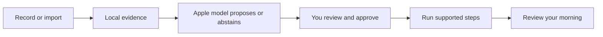

# MORE

**Less phone handling. More of the morning you enjoy.**

MORE — MOrning REcap — is an iPhone prototype that turns an explicitly shared glimpse of your morning into a routine you can review, adjust and run. Useful rituals—including messages, browsing and a game of chess—belong in the plan.

[V2 design](https://github.com/gibouu/morning-operator/blob/codex/more-quiet-morning/docs/V2-DESIGN.md) · [Get started](https://github.com/gibouu/morning-operator/blob/codex/more-quiet-morning/docs/ONBOARDING.md) · [Documentation](https://github.com/gibouu/morning-operator/blob/codex/more-quiet-morning/docs/README.md) · [Roadmap](https://github.com/gibouu/morning-operator/blob/codex/more-quiet-morning/docs/ROADMAP.md)



## Two tabs, a quieter morning

The development branch `codex/more-quiet-morning` introduces the V2 interface. It is **in progress and not yet installed on the owner's phone**. Review [PR #26](https://github.com/gibouu/morning-operator/pull/26), stacked on [PR #22](https://github.com/gibouu/morning-operator/pull/22). The source code on `main` remains the earlier scaffold; select the development branch when building the current iPhone app.

| Experience | V2 source behavior |
|---|---|
| Morning | A date, a compact routine and a clear start. Up to ten moments fit at default portrait size in the tested simulator; larger text and short layouts have a scrolling fallback. Pause and Stop remain reachable. |
| Review | Open a seven-day period and its days; revisit dated observations and their originals, edit and approve your routine, find saved thoughts, and open settings or connections. There is no separate Notes tab. |
| Show your morning | Explicit iOS 27 screen recording, or selected text/image/video import. Local extraction saves separate observations with original text and corrections; identical file imports keep the existing entry. Unknown recording dates stay explicit. Screen recognition is a separate, explicit action; routine proposals still require approval. Manual setup also works. |
| Move through it | Supported spoken/calendar operations advance after completion. Other activities wait for you. A completion invitation opens capture; it is not yet a live spoken conversation. |
| Begin with an invitation | Set one future notification in Review → Settings. Its tap or a foreground Start intent routes into an approved morning, waiting for a ready app. Physical delivery and Siri invocation remain unverified. [Morning entry](https://github.com/gibouu/morning-operator/blob/codex/more-quiet-morning/docs/MORNING-ENTRY.md). |
| Speak a command | An explicit on-device English/French turn supports next, pause, resume, skip, repeat and stop. Entry/cancel behavior is tested; real microphone recognition remains a device check. [Voice guide](https://github.com/gibouu/morning-operator/blob/codex/more-quiet-morning/docs/VOICE.md). |
| Keep what matters | Save local dreams and thoughts. Review reminder/calendar requests before an optional save to the corresponding Apple app. Preserve the rituals you want when shaping a routine. |

Review currently measures **routine runs**, not complete phone usage or learned app habits. Optional configured Shortcuts log selected app entries/returns with incomplete coverage. [The design contract](https://github.com/gibouu/morning-operator/blob/codex/more-quiet-morning/docs/V2-DESIGN.md) explains the layout, native controls and metric boundaries.

## Where it stands

**V2 source `d9a6120`:** Review now keeps separate observations across mornings. Open a day or Saved observations, keep corrections beside the original text, assign an unknown observed date, or delete one observation. Reimporting the same file preserves its identity and edits. Earlier ordered screen evidence and explicit Apple model recognition remain available without changing the approved routine. [How observation works](https://github.com/gibouu/morning-operator/blob/codex/more-quiet-morning/docs/OBSERVATION-METRICS.md).

The first controlled trial recorded two separate native test apps, two verified scroll movements and a selected synthetic message detail. MORE imported the actual 97-second video, retained its text after relaunch, and preserved existing notes when a later video contained no readable text. Those app checks passed again with the archive integration. Its correction, deduplication, deletion, date and old-data migration journeys also have passing results; the verification record distinguishes initial failures and corrected reruns. The latest separate video extraction retained 647 text regions across 24 samples; these are evidence regions, not detected actions. The [repeatable benchmark guide](https://github.com/gibouu/morning-operator/blob/codex/more-quiet-morning/docs/OBSERVATION-BENCHMARK.md) separates the known actions from model input.

**Recognition accuracy is still unproven.** Earlier model attempts found the Mac model unavailable and the simulator backend unsupported; all six simulator requests failed and the screens remained unknown. The archive update has **214 distinct shared checks passing across full and focused runs, with six optional checks skipped**, and the native app build succeeds. The verification record preserves the native-service failure and successful focused retry. The latest layout extraction and import/recovery checks ran without invoking a model. [Verification](https://github.com/gibouu/morning-operator/blob/codex/more-quiet-morning/docs/PHASE-ONE.md) keeps these results and earlier failures separate.

Earlier V2 checks cover compact layout, large text, saved observations, speech callbacks and a real simulator notification tap that starts an approved routine. Physical V2, cold/locked-device invitations, Siri invocation, microphone recognition and human-confirmed voice quality remain open. [Morning entry](https://github.com/gibouu/morning-operator/blob/codex/more-quiet-morning/docs/MORNING-ENTRY.md) explains the current start options.

**Installed phone baseline: `8a640ea`.** The signed app runs on the owner's iPhone. Six synthetic phone journeys passed, and a separate real on-device model example passed. A real short recording reached saved OCR, a visible unapproved draft and readable text after relaunch. These are results for the earlier phone interface, not a V2 installation.

That recording also exposed a quality problem: setup/marketing text became proposed habits. Targeted guard checks passed, and the updated filter rejects that saved input in a deterministic local replay. Broad habit accuracy remains unproven. Exact actions, scrolling, reels, reading intent and full morning duration are not established. The [verification record](https://github.com/gibouu/morning-operator/blob/codex/more-quiet-morning/docs/PHASE-ONE.md) keeps the physical baseline's passes, failures and pending checks separate.

Observed-habit averages, ongoing adaptation, first-use/alarm start opportunities and narrated cross-app actions remain [planned work](https://github.com/gibouu/morning-operator/blob/codex/more-quiet-morning/docs/ROADMAP.md). HomePod integration has its own hardware checks. The owner has not confirmed hearing the earlier phone speech checks.

## Build on your iPhone

The app targets iOS 26 or later; native recording needs iOS 27. Use full Xcode on the development Mac, your own signing team and a paired phone. The observed physical setup is Xcode 27 with iOS 27.0.1.

```sh
./scripts/check-environment.sh
open MorningOperator.xcodeproj
```

Select the **MorningOperator** target and your phone, then build/run the intended branch. Shared package checks run on the Mac with `./scripts/test.sh`; add `--with-model` only when deliberately testing the available local model. See [onboarding](https://github.com/gibouu/morning-operator/blob/codex/more-quiet-morning/docs/ONBOARDING.md) for setup and [device checks](https://github.com/gibouu/morning-operator/blob/codex/more-quiet-morning/docs/DEVICE-SETUP.md) for reproducible verification. The [short morning trial checklist](https://github.com/gibouu/morning-operator/blob/codex/more-quiet-morning/docs/DEVICE-SETUP.md#tomorrow-morning-checklist) describes the installed baseline; use the V2 contract for this branch's navigation.

The iPhone is the sole active product. The Mac is the development/test machine and optional tethered controller; no separate Mac app is required. The repository, Xcode target and bundle identity retain Morning Operator naming.

## Your data and the model

Extraction and Foundation Models inference run locally. There is no cloud-model fallback, model fine-tuning, billing or research-data upload pipeline. Saved routines, the observation archive with original/corrected text and ordered video samples, thoughts and local activity logs have different lifecycles; a finalized app-owned clip can remain for recovery until its extracted text is saved or the person discards it. Review [what is retained and what each clear control removes](https://github.com/gibouu/morning-operator/blob/codex/more-quiet-morning/docs/ARCHITECTURE.md#data-retention-today).

A later, separately opted-in mobile-agent research dataset is a [feasibility question](https://github.com/gibouu/morning-operator/issues/24), not current collection behavior.

## Explore the project

| Read | For |
|---|---|
| [Documentation hub](https://github.com/gibouu/morning-operator/blob/codex/more-quiet-morning/docs/README.md) | Find the right guide quickly |
| [V2 design contract](https://github.com/gibouu/morning-operator/blob/codex/more-quiet-morning/docs/V2-DESIGN.md) | Morning/Review, completion capture, native glass and honest metrics |
| [Morning entry](https://github.com/gibouu/morning-operator/blob/codex/more-quiet-morning/docs/MORNING-ENTRY.md) | One-time invitations, foreground Start, permissions and delayed-entry fallback |
| [Architecture](https://github.com/gibouu/morning-operator/blob/codex/more-quiet-morning/docs/ARCHITECTURE.md) | Components, states, data flows, model boundaries and Apple integrations |
| [Recording benchmark](https://github.com/gibouu/morning-operator/blob/codex/more-quiet-morning/docs/OBSERVATION-BENCHMARK.md) | Reproduce the controlled cross-app capture and inspect its measured limits |
| [Observation plan](https://github.com/gibouu/morning-operator/blob/codex/more-quiet-morning/docs/OBSERVATION-PLAN.md) | Consent, evidence, cycles, unknowns and multi-day learning |
| [Verified phone results](https://github.com/gibouu/morning-operator/blob/codex/more-quiet-morning/docs/PHASE-ONE.md) | Actual physical device/build/test evidence and open checks |
| [Roadmap and issues](https://github.com/gibouu/morning-operator/blob/codex/more-quiet-morning/docs/ROADMAP.md) | The next product slices and collaboration plan |
