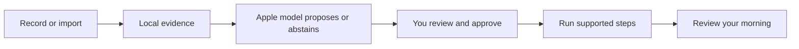

# Morning Operator

**Less phone handling. More of the morning you enjoy.**

An iPhone prototype that turns an explicitly shared glimpse of your morning into a routine you can review, adjust and run. Useful rituals—including messages, browsing and a game of chess—belong in the plan.

[Try it tomorrow](docs/DEVICE-SETUP.md#tomorrow-morning-checklist) · [Get started](docs/ONBOARDING.md) · [Documentation](docs/README.md) · [Roadmap](docs/ROADMAP.md)



## What you can do

| Experience | Current scope |
|---|---|
| Show your morning | Explicit iOS 27 screen recording, or import selected text, an image or video. Local extraction keeps the latest observation available for review. |
| Shape a routine | Apple Foundation Models proposes an unapproved draft. Edit the steps, preserve the rituals you want, then approve. Manual setup also works. |
| Move through the morning | A native timeline with pause, continue, skip and stop. Supported speech/calendar steps can advance after completion; other activities wait for you. |
| Keep a thought | Save local dreams and thoughts. Review reminder/calendar requests before an optional save to the corresponding Apple app. |
| Look back | Day navigation and seven-day routine-run history. Optional configured Shortcuts log selected app entries/returns; they are not a complete phone-usage log. |

## Where it stands

The signed app runs on the owner's iPhone. The latest six synthetic phone journeys passed, and a separate real on-device model example passed. A real short recording reached saved OCR, a visible unapproved draft and readable text after relaunch.

That recording also exposed a quality problem: setup/marketing text became proposed habits. Targeted guard checks passed, and the updated filter rejects that saved input in a deterministic local replay. Broad habit accuracy remains unproven. Capture success is not proof of accurate routine learning. Exact actions, scrolling, reels, reading intent and full morning duration are not established. The [verification record](docs/PHASE-ONE.md) keeps passing, failed and pending checks separate.

The simple week-average view of observed habits, ongoing adaptation, first-use/alarm start opportunities and narrated cross-app actions are [planned work](docs/ROADMAP.md). The [V2 design work](https://github.com/gibouu/morning-operator/issues/25) keeps that next experience simple. HomePod integration has its own hardware checks.

## Build on your iPhone

The app targets iOS 26 or later; native recording needs iOS 27. Use full Xcode on the development Mac, your own signing team and a paired phone. The observed setup is Xcode 27 with iOS 27.0.1.

```sh
./scripts/check-environment.sh
open MorningOperator.xcodeproj
```

Select the **MorningOperator** target and your phone, then build/run. Shared package checks run on the Mac with `./scripts/test.sh`; add `--with-model` only when deliberately testing the available local model. See [onboarding](docs/ONBOARDING.md) for the complete setup and [device checks](docs/DEVICE-SETUP.md) for reproducible verification.

The iPhone is the sole active product. The Mac is the development/test machine and optional tethered controller; no separate Mac app is required.

## Your data and the model

Extraction and Foundation Models inference run locally. There is no cloud-model fallback, model fine-tuning, billing or research-data upload pipeline. Saved routines, latest observation text, notes and local activity logs have different lifecycles; a finalized app-owned clip can remain for recovery until its extracted text is saved or the person discards it. Review [what is retained and what each clear control removes](docs/ARCHITECTURE.md#data-retention-today).

A later, separately opted-in mobile-agent research dataset is a [feasibility question](https://github.com/gibouu/morning-operator/issues/24), not current collection behavior.

## Explore the project

| Read | For |
|---|---|
| [Documentation hub](docs/README.md) | Find the right guide quickly |
| [Architecture](docs/ARCHITECTURE.md) | Components, states, data flows, model boundaries and Apple integrations |
| [Observation plan](docs/OBSERVATION-PLAN.md) | Consent, evidence, cycles, unknowns and multi-day learning |
| [Verified results](docs/PHASE-ONE.md) | Actual device/build/test evidence and open checks |
| [Roadmap and issues](docs/ROADMAP.md) | The next product slices and collaboration plan |

*MORE (MOrning REcap) is a working-name candidate. The app and repository remain Morning Operator.*
