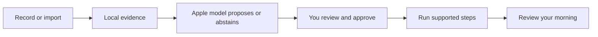

# MORE

**Less phone handling. More of the morning you enjoy.**

MORE — MOrning REcap — is an iPhone prototype that turns an explicitly shared glimpse of your morning into a routine you can review, adjust and run. Useful rituals—including messages, browsing and a game of chess—belong in the plan.

[V2 design](docs/V2-DESIGN.md) · [Get started](docs/ONBOARDING.md) · [Documentation](docs/README.md) · [Roadmap](docs/ROADMAP.md)



## Two tabs, a quieter morning

This branch, `codex/more-quiet-morning`, introduces the V2 interface. It is **in progress and not yet installed on the owner's phone**.

| Experience | V2 source behavior |
|---|---|
| Morning | A date, a compact routine and a clear start. Up to ten moments fit at default portrait size in the tested simulator; larger text and short layouts have a scrolling fallback. Pause and Stop remain reachable. |
| Review | Open a seven-day period and its days; edit and approve your routine, correct observations, find saved thoughts, and open settings or connections. There is no separate Notes tab. |
| Show your morning | Explicit iOS 27 screen recording, or selected text/image/video import. Local extraction keeps the latest observation available for review. The Apple model proposes an unapproved draft; manual setup also works. |
| Move through it | Supported spoken/calendar operations advance after completion. Other activities wait for you. A completion invitation opens capture; it is not yet a live spoken conversation. |
| Begin with an invitation | Set one future notification in Review → Settings. Its tap or a foreground Start intent routes into an approved morning, waiting for a ready app. Physical delivery and Siri invocation remain unverified. [Morning entry](docs/MORNING-ENTRY.md). |
| Speak a command | An explicit on-device English/French turn supports next, pause, resume, skip, repeat and stop. Entry/cancel behavior is tested; real microphone recognition remains a device check. [Voice guide](docs/VOICE.md). |
| Keep what matters | Save local dreams and thoughts. Review reminder/calendar requests before an optional save to the corresponding Apple app. Preserve the rituals you want when shaping a routine. |

Review currently measures **routine runs**, not complete phone usage or learned app habits. Optional configured Shortcuts log selected app entries/returns with incomplete coverage. [The design contract](docs/V2-DESIGN.md) explains the layout, native controls and metric boundaries.

## Where it stands

**V2 source `6f647b4`:** 138 shared checks passed with two optional model skips. A real local invitation appeared while MORE was backgrounded in the simulator; tapping it started the approved routine after a callback crash was found and fixed. Five other entry checks passed before that final delegate fix. Earlier V2 checks cover the compact layout, saved observations, largest text and speech-output callbacks. [The verification record](docs/PHASE-ONE.md) preserves each run and failure; this is not one full-suite pass.

The [entry guide](docs/MORNING-ENTRY.md) explains scheduling and fallback. Physical V2, cold-launch/locked-device invitations, Siri invocation, microphone recognition, human-confirmed voice quality and real habit accuracy remain unverified. The new [observation metrics core](docs/OBSERVATION-METRICS.md) preserves ordered evidence and comparable-day denominators; its recording adapter and movie benchmark are still pending.

**Installed phone baseline: `8a640ea`.** The signed app runs on the owner's iPhone. Six synthetic phone journeys passed, and a separate real on-device model example passed. A real short recording reached saved OCR, a visible unapproved draft and readable text after relaunch. These are results for the earlier phone interface, not a V2 installation.

That recording also exposed a quality problem: setup/marketing text became proposed habits. Targeted guard checks passed, and the updated filter rejects that saved input in a deterministic local replay. Broad habit accuracy remains unproven. Exact actions, scrolling, reels, reading intent and full morning duration are not established. The [verification record](docs/PHASE-ONE.md) keeps the physical baseline's passes, failures and pending checks separate.

Observed-habit averages, ongoing adaptation, first-use/alarm start opportunities and narrated cross-app actions remain [planned work](docs/ROADMAP.md). HomePod integration has its own hardware checks. The owner has not confirmed hearing the earlier phone speech checks.

## Build on your iPhone

The app targets iOS 26 or later; native recording needs iOS 27. Use full Xcode on the development Mac, your own signing team and a paired phone. The observed physical setup is Xcode 27 with iOS 27.0.1.

```sh
./scripts/check-environment.sh
open MorningOperator.xcodeproj
```

Select the **MorningOperator** target and your phone, then build/run the intended branch. Shared package checks run on the Mac with `./scripts/test.sh`; add `--with-model` only when deliberately testing the available local model. See [onboarding](docs/ONBOARDING.md) for setup and [device checks](docs/DEVICE-SETUP.md) for reproducible verification. The [short morning trial checklist](docs/DEVICE-SETUP.md#tomorrow-morning-checklist) describes the installed baseline; use the V2 contract for this branch's navigation.

The iPhone is the sole active product. The Mac is the development/test machine and optional tethered controller; no separate Mac app is required. The repository, Xcode target and bundle identity retain Morning Operator naming.

## Your data and the model

Extraction and Foundation Models inference run locally. There is no cloud-model fallback, model fine-tuning, billing or research-data upload pipeline. Saved routines, latest observation text, thoughts and local activity logs have different lifecycles; a finalized app-owned clip can remain for recovery until its extracted text is saved or the person discards it. Review [what is retained and what each clear control removes](docs/ARCHITECTURE.md#data-retention-today).

A later, separately opted-in mobile-agent research dataset is a [feasibility question](https://github.com/gibouu/morning-operator/issues/24), not current collection behavior.

## Explore the project

| Read | For |
|---|---|
| [Documentation hub](docs/README.md) | Find the right guide quickly |
| [V2 design contract](docs/V2-DESIGN.md) | Morning/Review, completion capture, native glass and honest metrics |
| [Morning entry](docs/MORNING-ENTRY.md) | One-time invitations, foreground Start, permissions and delayed-entry fallback |
| [Architecture](docs/ARCHITECTURE.md) | Components, states, data flows, model boundaries and Apple integrations |
| [Observation plan](docs/OBSERVATION-PLAN.md) | Consent, evidence, cycles, unknowns and multi-day learning |
| [Verified phone results](docs/PHASE-ONE.md) | Actual physical device/build/test evidence and open checks |
| [Roadmap and issues](docs/ROADMAP.md) | The next product slices and collaboration plan |
