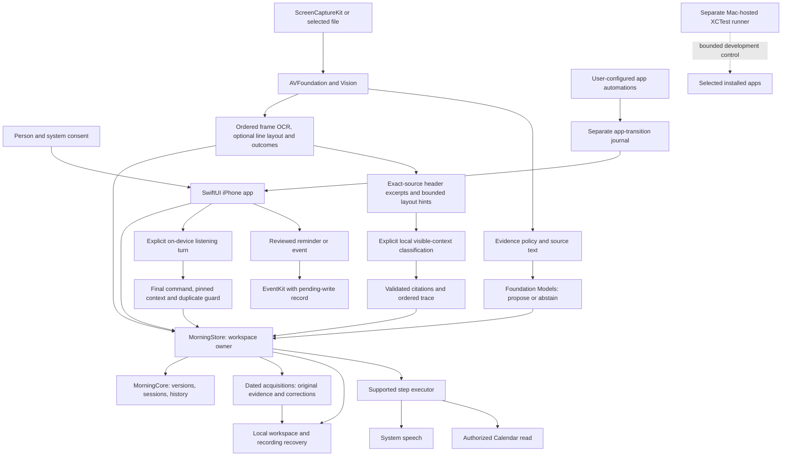
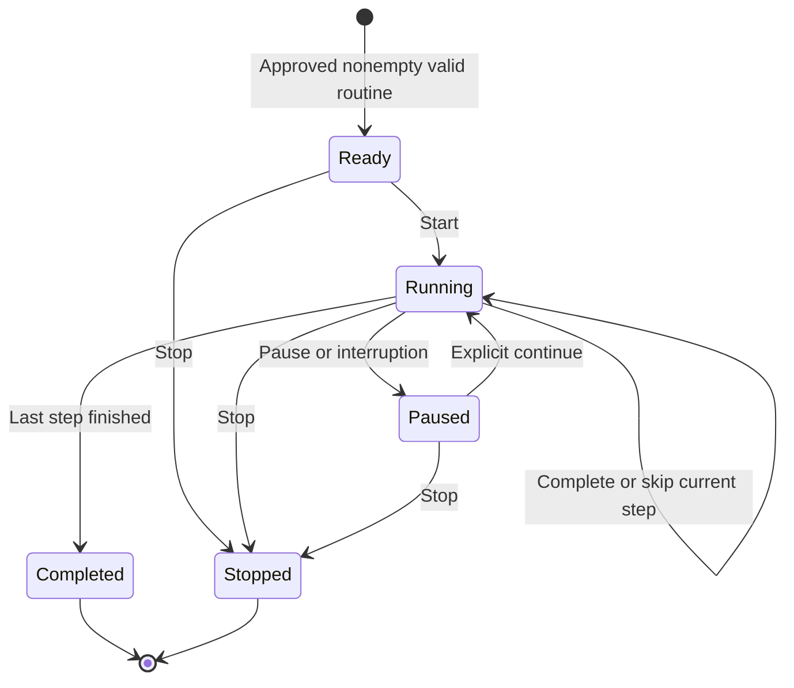
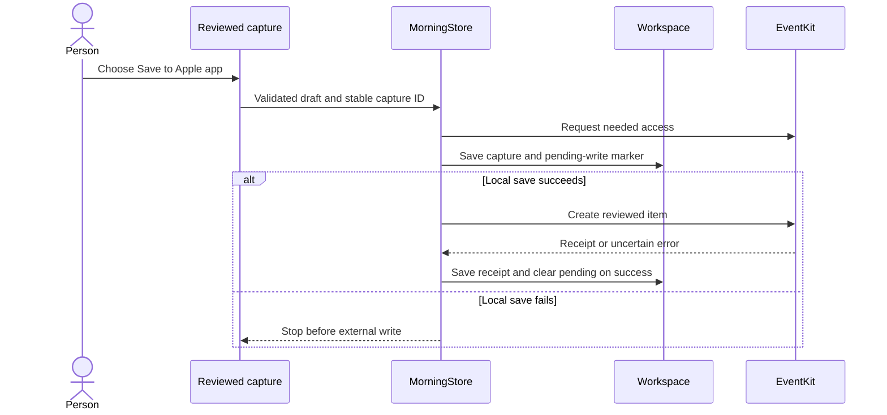

# System architecture

MORE is an iPhone app for observing a deliberately shared part of a morning, proposing a routine and helping the person run supported steps. The current implementation is local and has no backend or third-party runtime packages. The Mac is a development/test host and optional tethered controller; there is no separate Mac product target.

This guide describes source architecture and its limits. [PHASE-ONE](PHASE-ONE.md) is the authority for actual test results; [the roadmap](ROADMAP.md) separates upcoming work. MORE (MOrning REcap) is the V2 display name; the bundle, repository and Xcode target retain Morning Operator identities.

The structured extraction and latest-frame persistence path has controlled simulator recording/import evidence. Successful context inference and its semantic accuracy remain unverified: the Mac model was unavailable, and the subsequent simulator recognition requests failed in a required backend. The layout evidence slice is source `fb0e4a2`; its shared checks, native build, real Vision movie extraction and simulator import/edit/clear/blank-preservation checks passed. Those results do not establish semantic accuracy or replace the earlier physical-phone evidence. See [observation metrics](OBSERVATION-METRICS.md) and [the benchmark record](OBSERVATION-BENCHMARK.md).

Source `d9a6120` adds the observation archive, recording-date provenance and local file fingerprint described below. Shared checks and the native build pass, and six archive/import journeys have passing results across the initial and corrected runs. [Verification](PHASE-ONE.md) preserves the native-service and accessibility-test failures and their targeted reruns. Physical recording-date behavior and V2 installation remain unverified.

## Components and boundaries

There is no app-runtime connection from the model to arbitrary phone controls. Recording can expose visible content; it cannot itself send a tap or grant access to an app's private data. The XCTest runner is a separate execution environment, not an entitlement held by the installed product.

| Module | Responsibility | Main source |
|---|---|---|
| `MorningCore` | Codable domain objects, recording/fingerprint metadata, routine/session invariants, timing/history, atomic JSON and action-journal primitives | [Core sources](../Sources/MorningCore) |
| `MorningApple` | Observation acquisition/archive validation, media extraction, local file fingerprints, evidence filtering, local inference, recording/recovery, speech, Calendar/Reminders and transition storage | [Apple adapters](../Sources/MorningApple) |
| iPhone application | Views, one main-actor workspace owner, lifecycle coordination and App Intents | [App sources](../Sources/MorningOperator) |
| Development harness | Isolated synthetic journeys, selected external-app checks and dedicated observation-benchmark fixture targets | [UITests](../UITests), [fixture apps](../Benchmarks/FixtureApps) |

The project targets iOS 26. Native ScreenCaptureKit recording is guarded for iOS 27; selected-file import remains available on the older baseline. Shared package checks target macOS 26 or later. Availability declarations do not replace actual device/model/permission checks.

`MorningBenchmarkInbox`, `MorningBenchmarkCalendar` and `MorningObservationBenchmarkUITests` belong to a dedicated benchmark scheme. Their synthetic inbox/calendar content and controller are not embedded in the shipping `MorningOperator` app; the ordinary UI-test target excludes the benchmark controller. These targets support a controlled comparison, not a runtime permission to control other apps.

## Capture, recover, extract

The person chooses **Record a little of my morning**, selects a duration and confirms Apple's picker. The current UI defaults to **20 minutes**, with 5/10/20/30-minute choices and a 256 MiB bound. This is an elapsed-time cap, not detection of inactivity. The stop request and confirmed stream/file completion can happen at different times.

```mermaid
stateDiagram-v2
    [*] --> Idle
    Idle --> SystemPicker: Person starts
    SystemPicker --> Starting: Person shares
    SystemPicker --> Idle: Cancel
    Starting --> Recording: Capture acknowledged
    Recording --> Stopping: Stop, limit or interruption
    Stopping --> Stopping: Stop uncertain; retain owner and retry
    Stopping --> SavedClip: Confirmed stop and finalized file
    SavedClip --> Extracting: Foreground and idle; same session or Retry
    Extracting --> SavedClip: Blank, OCR, cancellation or save failure
    Extracting --> SavedText: Readable text and frame evidence saved
    SavedText --> Draft: Eligible evidence and model available
    SavedText --> NeedsReview: Insufficient evidence or model unavailable
    SavedClip --> Idle: Explicit discard
```

`ScreenRecordingService.shared` owns the stream independently of sheets. Its finalization callback stages a successfully finalized clip into one durable recovery slot before releasing ownership. The foreground coordinator starts same-session extraction only when the app is active and no analysis or routine session is in progress. A clip recovered after app relaunch requires **Retry**; relaunch does not silently reprocess it.

The app closes its own Record/Learn sheets when it can handle acknowledged capture in the active scene. Apple's sharing panel is a separate system surface: it remained visible seven seconds into an observed clip. Automatic dismissal is not established. Use the system's normal dismissal/navigation controls; do not interpret an open panel as proof that capture has not started.

Non-user interruption can retain a successfully finalized clip with a coverage note. An unfinalized/writer-failed file is not treated as a usable recording. Stop errors keep resources/status for retry; a failed ownership handoff keeps the service's file rather than silently losing it. These source protections still need broad hardware coverage across interruption, locking and limits.

The importer reads a selected image, video or UTF-8 file with scoped file access. Video is capped at 512 MiB and 31 minutes in current source, allowing a small completion margin around the 30-minute recording option. AVFoundation requests at most **24 frames**. One extraction pass retains a stable per-request ID, requested/actual timestamp or labeled fallback, OCR text, blank/decode/OCR outcome and warnings. A 30,000-character/256,000-byte OCR budget leaves room for labels within 32,000 rendered characters. Truncated/omitted text is explicit and cannot support context identification. Notes deduplication never removes the original structured samples.

The same Vision pass now adds optional `ObservationOCRLine` records: stable local line IDs, exact text and Swift Character ranges, candidate recognition confidence, and approximate candidate-range bounds in normalized lower-left image coordinates. Bounds describe the oriented decoded image, not exact glyph outlines, tappable controls or verified app identity. Core validation rejects invalid bounds/confidence, duplicate IDs, unordered or overlapping spans, and text that differs from the exact source; decoding repeats validation. At most 256 line records are retained per frame. Legacy frames with no layout field decode with `nil`; an empty or partial array does not establish complete layout coverage. [Apple candidate-range bounds](https://developer.apple.com/documentation/vision/recognizedtext/boundingbox(for:)).

The adapter preserves the existing trimmed-line order and newline-joined OCR text before extraction limits. Missing/invalid/capped geometry produces warnings while keeping that text; bounds are not clamped or guessed. If the text budget clips a line, only unchanged whole line records that fit the retained prefix survive. Source-truncated frames remain ineligible for context identification.

Bounded OCR bodies, optional line layout and frame metadata are saved with each accepted observation acquisition in the workspace; sampled pixels are not persisted. All-blank extraction returns diagnostics to its caller, but the store preserves the previous observation and keeps an owned raw clip for retry rather than replacing good evidence with empty text. The whole video can contain activity absent from the samples. File duration does not declare wall-clock capture start or complete continuous coverage. [Detailed evidence contracts](OBSERVATION-METRICS.md).

The observed real clip proved capture → OCR → saved text → visible unapproved draft and readable text after ordinary-app relaunch. It also produced incorrect habits from setup/marketing text. The updated policy now rejects the same saved text in a deterministic local replay, without a new model call or changing the original text. This demonstrates why transport, visibility and semantic correctness need separate checks. [Apple iOS capture sample](https://developer.apple.com/documentation/screencapturekit/capturing-screen-content-on-ios), [Vision text recognition](https://developer.apple.com/documentation/vision/recognizetextrequest).

## Observation acquisitions and dates

The workspace now holds an `ObservationArchive` and a selected acquisition ID. Each acquisition retains its original text, optional original video evidence, optional current correction and validated classification. Learn projects the selected acquisition into its editor; importing another readable file adds/selects an entry without deleting earlier observations. Review offers the archive, dated day details and a separate **Date needed** collection. This retains evidence across mornings; it does not yet calculate an observed-habit average.

`importedAt` records import time separately from an optional observed date and its time-zone/provenance. Native `ObservationRecordingContext` contains a session UUID and the wall-clock instant/time zone observed at the recording-output start callback, captured before the main-actor hop. It survives finalized-file recovery and retries, then clears when the recorder transfers/discards the clip or begins a new session. This is not a physical-pickup signal or exact alignment with video PTS zero. A file import or legacy observation has no observed date by default; neither file dates nor media timestamps supply it. The person can explicitly assign/change the observed day and zone. Origin separately records human, automated, synthetic or unknown activity; recording alone does not prove a human origin.

`ObservationFileFingerprintService` reads the explicit local file with CryptoKit SHA-256 in 1 MiB chunks, with a 512 MiB limit, cancellation and file-change checks. The importer checks the digest again after extraction before committing evidence. Exact-byte reimports select the existing acquisition and retain its identity, corrections, dates and origin. This is deduplication, not semantic equivalence or proof of media authenticity. No source path, file contents or raw file errors are logged by the fingerprint service. Its result contains SHA-256 and byte count; the archive retains SHA-256. The acquisition's local source label can still contain the selected filename.

Corrections change the text used for routine suggestions while preserving original text and original frame evidence. Editing removes attached classification; reverting the correction does not resurrect it. Unsupported saved derived classification can be dropped with a warning while preserving valid original evidence. Delete one/Delete all removes archived observation evidence after a successful workspace save, without deleting routines, their existing quotations, run history or a raw recording awaiting recovery. Manual edits save at editing/lifecycle boundaries and before import/analysis; failed writes retain edits and keep owned raw media available for retry.

The archive is bounded and rejects an addition that exceeds its limits instead of silently evicting an older observation:

- At most **60 acquisitions**.
- Original text at most **33,000 characters**, including an optional bounded recording-coverage prefix; a correction at most **32,000 characters**. Each text field is also capped at **300,000 UTF-8 bytes**.
- At most **8 MiB of aggregate text** across original/corrected text, frames, OCR lines and prepared excerpts, plus **20,000 OCR line records**.
- At most **16 MiB of compact-encoded archive JSON**. This is an archive validation limit, not a bound on the whole formatted workspace file and its other data.

Records and selected ID share the existing schema-1 workspace's atomic save. Legacy single-observation data migrates with unknown import/observed dates; acquisition identity is saved once migration succeeds. Same-ID inserts with conflicting source/digest are rejected; the same text without a file digest is not automatically treated as the same acquisition. Raw recovery remains one separate slot, not a video library: only a successful archive/workspace save or an explicit discard permits removal of its video and metadata. A crash after the workspace save but before raw cleanup can reselect the existing digest on retry.

## Foundation Models: inference, not training

`AppleIntelligenceService` checks `SystemLanguageModel.default.availability`. If the device is ineligible, Apple Intelligence is disabled or the model is not ready, the app shows the reason. Manual routines and review remain available. There is no silent cloud fallback.

The current evidence-policy revision separates user-reported activity from visible task content. It filters whole visual frames before chunking, rejects recognized setup/picker/launcher/marketing contexts, and allows an insufficient-evidence outcome. This is a targeted, incomplete heuristic. Rejection by that deterministic prefilter happens before model inference; it is distinct from the model returning its own insufficient-evidence outcome. Deterministic guard tests do not establish real-model abstention. The validation record is in [PHASE-ONE](PHASE-ONE.md).

The original trimmed observation must fit within 8,000 characters before filtering; filtering does not rescue an oversized input. Equivalent eligible frames are deduplicated and coalesced into inference chunks of at most 1,500 characters. Dynamic guided-generation schemas constrain outcome, step category, evidence kind, quote and tentative duration. Post-generation checks require an eligible source context and exact supporting quotation, valid kind/duration and matching evidence type. Duplicate proposals are collapsed. The resulting routine is **unapproved**, with no inferred execution operation attached.

A matching quote proves only that text appeared in the input. It does not prove that the person opened an app, read a message, performed the activity or repeats it daily. A screenshot is a moment. Durations generated by the model are suggestions, not measurements. Source text is untrusted data and cannot approve a plan, change consent, invoke an external tool or override app policy.

The separate `ObservationContextClassifier` is explicitly invoked from Learn's **Recognize sampled screens** control. It preserves the original ordered frames and selects a contiguous, unmodified OCR prefix of at most **320 characters and six whole nonempty lines** from each eligible frame. An overlong line ends selection; later text is not substituted. These excerpts, IDs and media times enter bounded native-model batches, independently of routine-learning deduplication. Full bounded source OCR and exact stored geometry remain saved. The `whole-line-source-prefix-layout-v2` preparation policy can add at most six layout hints whose complete line spans lie in the selected prefix. Hint coordinates and OCR confidence are rounded to six decimal places; exact source values stay unchanged. Optional hints are removed before excluding text if a single-frame prompt would exceed its limit. `inputSelection` records the policy, source lengths, selected offsets, excerpt text and selected line IDs; older saved classifications can omit this metadata, and its presence does not imply a model request occurred.

Validation binds each accepted decision to its exact sample ID, media time, source reference and a quote present in both the selected excerpt and original frame. The context classifier and trace adapter compare quotation UTF-8 bytes, rejecting canonically equivalent Unicode rewrites that only look identical. Blank, failed, source-truncated, omitted or over-budget frames remain unknown. Deliberate header selection is distinct from source truncation. Classification is saved with its acquisition and revalidated after reload; editing that observation removes its classification. Selecting/importing another acquisition leaves earlier entries intact. Cancellation plus evidence/acquisition-ID checks prevent a stale result from attaching to another import.

These are `visual-context:` labels, not verified app identities. Generic early-header matching can see Inbox → Alex → Inbox inside one app. Catalog matching permits leading punctuation/symbol decoration, but competing catalog mentions block identification and alphabetic OCR damage is not repaired. Neither rule proves foreground-app identity. Layout hints do not relax these checks or let a high/large text region resolve competing catalog names. Learn therefore displays recognized appearances rather than OS entry or scroll counts.

The earlier text-only preparation replay retained all **24 baseline samples**, selecting **2,217 characters**, without changing the saved full source. This is input eligibility, not successful classification. The earlier Mac attempt reported **model not ready, with zero requests**. A subsequent simulator attempt reported availability, then **six failed requests, zero responses and 24 unknown decisions**. The app process's native log reported `operationNotAllowed: Simulator is not supported` in a required backend. That is a runtime support failure, not evidence that the synthetic content violated a policy or that the model abstained. No physical-device context-model benchmark has run. Earlier phone routine-generation results remain separate evidence. [Observation metrics](OBSERVATION-METRICS.md), [benchmark record](OBSERVATION-BENCHMARK.md).

“Learning” currently means interpreting the supplied observation and saving an editable routine/preferences. No fine-tuning, adapter training, weight update, persistent model memory, embedding index or research corpus is implemented. Future four/five-day estimates and continuous per-morning adaptation belong to [#11](https://github.com/gibouu/morning-operator/issues/11) and [#21](https://github.com/gibouu/morning-operator/issues/21); they need evidence and ordinary data aggregation, not a claim that the foundation model retrains each morning. [SystemLanguageModel](https://developer.apple.com/documentation/foundationmodels/systemlanguagemodel), [guided generation](https://developer.apple.com/documentation/foundationmodels/generating-swift-data-structures-with-guided-generation).

## Routine and session state

`RoutineVersion` contains ordered `RoutineStep` records. Edits create an unapproved version; one prior approved version can be restored until the replacement is approved. This is not a complete version-history browser. A run pins a snapshot of its approved version.

An inferred draft retains the previous personal routine's required rituals with their full user-owned values. Unique stable identities or unambiguous normalized title/category matches prevent obvious duplication; uncertain matches remain separate for review. Sample rituals do not transfer into personal learning. There is no persisted journal of every correction or removal yet, so non-required edits are not comprehensively reconciled across future proposals.

An unapproved/empty/invalid routine cannot start. A repeated advance command ID cannot skip two steps. Pause, stop and manual advance cancel the current execution attempt; stale callbacks cannot advance another session or step. A running checkpoint restored at launch becomes paused, and its interrupted duration is unknown rather than including unobserved time.

Automatic progression uses explicit `RoutineStepAutomation` operations: `spokenNote` and `todayCalendar`. A generated category such as messages/calendar is not an operation. Other steps wait for the person's Next. Speech completion proves synthesis finished; it does not prove the person heard it or performed a real-world activity. Calendar speech reads a fresh authorized day snapshot. The workspace is saved before dispatch; save failure pauses rather than continuing effects.

The explicit [voice-command turn](VOICE.md) pauses first, awaits speech-output release, then permits a bounded on-device microphone turn. A whole-turn final hypothesis must match a strict command grammar; microphone release, the pinned session/version/step and an unused turn ID must all be confirmed before applying it. Next/skip from paused apply an atomic resume-and-advance transition without first dispatching the old step. Repeat reads the current detail while leaving the run paused. New speech stays blocked while input or unresolved microphone cleanup owns audio. This is a command flow, not a continuously listening conversation.

The [morning-entry flow](MORNING-ENTRY.md) routes a person's notification tap or authenticated foreground Start intent through one readiness policy. It waits for active, unoccupied UI and released microphone ownership, uses a fixed 60-second request lifetime, and never approves a draft or starts recording. A separate invitation service stores a one-time occurrence and consumes an eligible tap before the workspace atomically saves its entry receipt and run transition. A crash between those files can require manual Start: this is at-most-once automatic entry, not a cross-file transaction. A running session is revealed without repeating its current operation. Native notification delivery and actual Siri/locked-phone entry remain unverified.

## Notes, permissions and effects

Thoughts and dreams save locally. Reminder/calendar ideas can remain local or be deliberately saved through EventKit after text/date review. The deterministic date parser supplies editable suggestions; it is not universal date understanding. Calendar reads need full access; event creation can use write-only access, and Reminders uses its relevant full-access permission.

A receipt prevents an ordinary duplicate retry. If the process stops after an external write but before the receipt is saved, the outcome remains uncertain; inspect Calendar/Reminders before trying again. An EventKit receipt is a local system-store result, not proof of cloud sync or an alert being heard. Apple items follow their chosen accounts' sync policies.

Core `ActionJournalStore` also implements scoped approvals and unknown-outcome recovery for future adapters. It is not yet a universal integrated cross-app action engine; current EventKit capture uses the explicit pending/receipt fields above. General observe → narrate → act → verify work is [#7](https://github.com/gibouu/morning-operator/issues/7), with effect integration in [#12](https://github.com/gibouu/morning-operator/issues/12). [Event-store access](https://developer.apple.com/documentation/eventkit/accessing-the-event-store).

## Data retention today

The following describes actual local storage and controls, not a proposed privacy policy. Ordinary app data lives under its Application Support directory. JSON uses a schema envelope and atomic replacement with owner-only file permissions; there is no app-level encrypted database or account/cloud-sync service. Do not equate local storage with exclusion from every device backup: only the recording-recovery directory is explicitly excluded in this implementation.

| Data | Stored today | Retention / removal today |
|---|---|---|
| Routine, one previous approved version, current session, run history, voice/settings | `workspace.json` | Remain across launch; edits/approval replace the active/prior-version slots. No general history-expiry or delete-all UI. Archived runs retain their pinned routine content. |
| Bounded observation acquisitions: original/corrected text, frame OCR/layout, optional classification, identity, digest, dates/provenance and origin | Same `workspace.json`; archive plus selected acquisition ID | Readable new imports add/select entries; exact-byte reimports preserve existing corrections/dates. Blank imports leave entries intact. Editing removes classification but preserves original text/frame evidence. Delete one/Delete all removes observation entries; existing routine/history quotations remain. No automatic expiry or silent eviction. No sampled pixels or extra raw archive are added. |
| Thoughts/dreams/capture requests, pending effect markers, receipts | Same workspace | Persist locally. No general saved-thought deletion/expiry UI is currently implemented. Clearing observation text does not remove these items. |
| One-time invitation | `morning-invitation.json` | One ID, scheduled instant, display zone, expiry, status and optional consumption time; no routine content. Replacement creates a new ID. Cancel removes this feature's native notification and may retain canceled metadata; Reset repairs unreadable invitation data without erasing the workspace. |
| Recent morning-entry receipts | `workspace.json`; up to 64 IDs | Saved with the start/resume transition before dispatch. Separate from invitation consumption; a crash between files can require manual Start. |
| Microphone command audio and transcript | In-memory only; no audio file or transcript in workspace/history | Audio input ends after the explicit turn. Temporary transcript can remain visible until another turn or the app lifetime ends. Resulting ordinary session events persist, but recognition text is not a learning dataset. |
| Active app-created recording | App temporary recording directory | Moved after finalization into recovery, or removed on confirmed discard/failure cleanup. A force-terminated/unfinalized temporary file is not a guaranteed recoverable clip. |
| One pending finalized clip, interruption note and optional native session-start context | `RecordingRecovery/pending-screen-recording.mp4` and `recording-info.json` | Directory excluded from backup; metadata has owner-only permissions. Kept after blank/OCR/cancellation/archive-save failure; Retry/Discard on relaunch. Removed only after the archive/workspace save or explicit discard. Legacy metadata has no context; orphaned metadata supplies no date for another clip. No automatic age expiry. Later model/classifier failure does not require retaining raw video. |
| User-selected original media | Its original Files/Photos location | Only read through selected access; the app does not delete the original. |
| Per-app callback journal | `app-transitions.json` | App/entry-exit/time/time-zone/source/ID, no screen/message contents. Clear recorded app activity removes it; enabled Shortcuts may add new events afterward. No automatic expiry/export UI. |
| Calendar snapshot | In-memory adapter/store state | Refreshed on read; not part of workspace persistence. Reviewed items saved to Apple apps are managed by those apps/accounts. |
| Routine export | Person-selected JSON file | Contains the selected routine, including evidence details; it is not a full workspace export or automatic redaction. Review before sharing. |
| Device-test screenshots, recordings and result bundles | Local developer `work/` and `.build/` artifacts | Separate from app controls and ignored by Git. Cleanup is a deliberate developer action. Never attach personal artifacts to issues by default. |

There is no telemetry upload, backend ingestion, HealthKit store or research-contribution pipeline in current source. No model training data is created automatically. The separate [research feasibility issue #24](https://github.com/gibouu/morning-operator/issues/24) considers deliberately selected, reviewed/redacted contributions only after distinct participation, retention, rights and export decisions. It does not repurpose recovery clips or extend retention today. Broader export/forgetting controls are [#8](https://github.com/gibouu/morning-operator/issues/8).

## Daily review, app loops and the intended weekly view

Current day/week history measures Morning Operator sessions, with planned duration separated from measured active/paused/elapsed time. Stopped and completed runs differ; interrupted timing and missing observations stay unknown; synthetic fixtures are excluded from personal aggregates. It does not establish total phone usage or time saved.

Optional background `LogAppTransitionIntent` receives manually configured Shortcuts events for Instagram, TikTok and Snapchat. A separate actor serializes its same-process JSON writes. Supplied stable IDs deduplicate intentional retries; omitted IDs are new events. Review shows Today's entries and returns after another tracked app. Callbacks can be late/missing and unconfigured apps can be absent. These are not physical pickups, exact process launches, scroll counts or a full ordered device log. Installed Shortcuts delivery still needs its own evidence. [Apple App triggers](https://support.apple.com/guide/shortcuts/setting-triggers-apde31e9638b/ios).

`ObservationVideoEvidence.makeTrace` connects validated classification decisions to ordered `ObservationTrace` samples. Learn reviews the selected trace's recognized appearances; the app supplies no trusted continuous-capture intervals, so capture-duration and sampled-time estimates remain unknown. The new archive keeps separate observations and makes their observed dates/origins reviewable. `ObservationTraceWindowReport` implements comparable-day denominators, but archive entries are not yet aggregated into observed-habit averages. Retained observations do not establish measured app use, OS opens, scrolls or a learned personal average.

The intended product UI is a **simple weekly average** with understandable coverage, supported by four or five comparable mornings and continued bounded learning afterward. That external-app/habit average is planned, not implemented. Each metric needs its own evidence-day denominator; missing days are not zero. Separate human-led, assistant-executed, mixed and synthetic segments so automation does not teach itself a false human preference. Optional habit-reduction targets preserve enjoyment and belong to the person. Detailed contracts live in the [observation plan](OBSERVATION-PLAN.md); the simpler next interface is tracked in [V2 design work #25](https://github.com/gibouu/morning-operator/issues/25).

## Start signals, voice and prepared briefings

| Integration | Current behavior / boundary | Next work |
|---|---|---|
| One-time invitation | Explicit future notification preference; tap enters only after readiness/approval checks. Fixed absolute instant and separate durable consumption | Verify permission, actual delivery, cancellation/replacement, time-zone behavior and locked-phone entry. It is not a wake sensor or recording trigger. |
| Siri / App Intents | Start requests immediate foreground execution and local-device authentication; drafts open review, capture text remains reviewed | Verify installed discovery, spoken invocation, cold launch and locked-device behavior. See [morning entry](MORNING-ENTRY.md); no global custom wake word. |
| Speech output | `AVSpeechSynthesizer`, installed language/dialect/quality-aware voice choice, awaited audio ownership, completion/cancellation and output-route UI | Earlier phone callbacks passed; V2 has separate checks. Human-confirmed voice quality, interruptions and HomePod remain open. This is not a trained companion voice. |
| Voice commands | Explicit on-device `SFSpeechRecognizer` turn with local-only requirement, strict English/French grammar and touch fallback | Source compiles and entry/cancel UI is tested; actual microphone/recognition/route trials remain pending. See [voice guide](VOICE.md). No global wake word or continuous conversation. |
| Calendar / Reminders | Authorized reads and reviewed EventKit writes in source | Real-account permission/write checks with receipts and correct dates. |
| Alarm / sleep Shortcuts | No wake-trigger automation installed by the app | Apple's Alarm stopped/snoozed/Wake-up and Sleep waking-up triggers can offer a start opportunity; they do not authorize a fresh screen capture. |
| DeviceActivity | No first-use extension or usage-data connection implemented | Test first use within a scheduled interval and separately entitled aggregate data access; neither is a physical-lift sensor or live ordered tap stream. |
| HomePod / AirPods / Apple TV | User-selected iPhone output route; one available HomePod mini | Verify audio output independently. No raw HomePod microphone, autonomous room detection or room-to-room transfer is established. |
| Health, weather, email/messages, HomeKit | No complete connected pipeline in this app | Separate adapters, permissions, evidence and freshness checks. An observed message is not a mailbox connection. |

Preparing a recap or speech buffer in advance is a useful future latency experiment. Cache only supported, authorized connected data with source time, generation time and expiry; revalidate calendar/date/account and volatile information before speaking. Do not describe preparation as overnight model training, assume access to unconnected inboxes, or promise guaranteed iOS background execution. It must preserve user stop and safe audio-route behavior. [Speech audio session](https://developer.apple.com/documentation/avfaudio/avspeechsynthesizer/usesapplicationaudiosession), [SpeechAnalyzer](https://developer.apple.com/documentation/speech/speechanalyzer).

Official trigger references: [Alarm and Sleep automations](https://support.apple.com/en-ie/guide/shortcuts/apd932ff833f/ios), [DeviceActivity first-use callback](https://developer.apple.com/documentation/deviceactivity/deviceactivitymonitor/intervaldidstart(for:)), [direct usage-data API](https://developer.apple.com/documentation/deviceactivity/deviceactivitydata/activitydata(filteredby:using:)). Entitlement, authorization, region and freshness details remain in the [observation plan](OBSERVATION-PLAN.md).

## Protected content and verification

The owner reported a WhatsApp recording problem. A bounded tethered screenshot check later showed the ordinary Chats screen was readable, without opening a conversation or sending a message; it did not test native ScreenCaptureKit recording. Diagnose the particular screen and capture mode on the actual device; do not generalize from one failure to all chats or recordings. WhatsApp documents screenshot blocking for View Once content, which does not establish the behavior of ordinary text chats or every recording mode. Protected/blank/unavailable content stays unknown. No bypass is promised. [WhatsApp View Once guidance](https://faq.whatsapp.com/1077018839582332).

Validate each boundary with controlled input: source media exists, expected visible text is extracted, persistence succeeds, UI matches, model claims are supported and actions have observable postconditions. [Benchmark #23](https://github.com/gibouu/morning-operator/issues/23) owns this measurement work. An insufficient-evidence result can be correct. A routine constructed from onboarding copy is not successful habit learning even when every lower-level data transfer worked.

Use [tomorrow's short checklist](DEVICE-SETUP.md#tomorrow-morning-checklist) for the immediate phone trial. Keep broader control, automatic scheduling, multi-day inference and research collection in their own issues until they have evidence.
