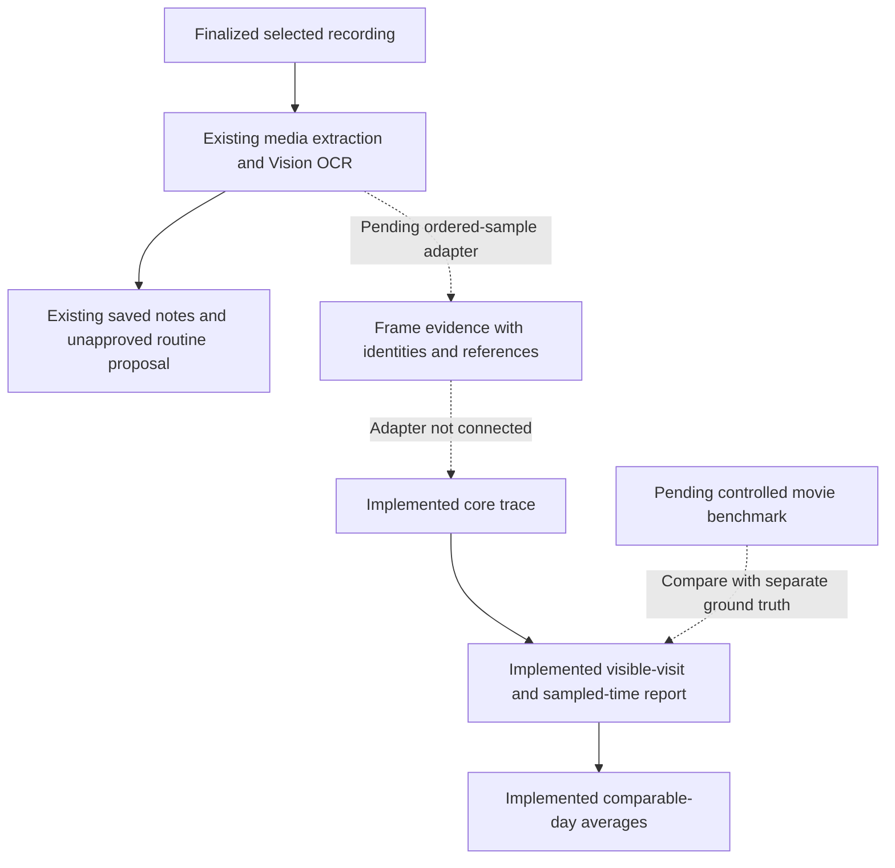

# What an observation can tell us

**Implemented in the core library; recording integration and the controlled movie benchmark are pending.** All eleven focused tests passed in the 10 October package run: 138 checks passed overall, with two optional model tests skipped. This work adds no device, model, capture or cross-app accuracy result.

MORE needs to distinguish a screen being visible from an app being opened, a gesture being issued, and a person reading something. The new trace preserves ordered evidence and produces conservative reports without turning those different events into one count.

## Current boundary

[`ObservationTrace`](../Sources/MorningCore/ObservationTrace.swift) and [`ObservationTraceWindowReport`](../Sources/MorningCore/ObservationTraceWindow.swift) are pure Swift value types. They validate supplied evidence and calculate reports. They do not capture a screen, identify apps, call Foundation Models, save a history or populate Review.

The existing importer samples at most 24 video frames. Its text output removes consecutive identical OCR; the routine-learning evidence policy additionally deduplicates equivalent eligible frames globally and strips timestamps before inference. Those choices keep routine generation bounded, but they can erase a return to an identical screen. A future adapter must emit the trace **before** that deduplication. A routine proposal's planned minutes are not measured observation time.

## The trace contract

Each sample has a stable ID, a relative media timestamp, an actual-presentation or requested-sampling time basis, and an outcome: observed, blank, decode failure or OCR failure. App evidence is identified with a source reference, ambiguous with a reference, or unknown. A context key is not automatically a verified bundle identifier.

The trace preserves samples in supplied chronological order. Invalid/nonfinite/out-of-range times, decreasing times, duplicate sample IDs, overlapping coverage intervals and inconsistent names for the same context key are rejected. Decoding a saved trace repeats validation. Equal timestamps are allowed: agreeing app claims form one moment; conflicting or unknown claims make that moment unresolved rather than inventing an order.

Coverage intervals mean **verified continuous captured spans**. An isolated observed frame may exist outside those spans while the surrounding duration remains unknown. Adapters must not use these intervals to mean “definitely absent media” and simultaneously supply observed frames from that absence. `nil` means continuous capture coverage is unknown; an empty array means no supported continuous span. Complete declared capture does not establish complete semantic analysis.

The core checks structure and references, not whether an OCR/model app identification is correct. Source references must remain resolvable by the future adapter. A nonempty reference string is not independent proof of an action.

## Visible visits and time

| Report value | Meaning and limitation |
|---|---|
| Minimum visible visits | Ordered appearances separated by another identified context. Includes an app already visible at the start; it is not an OS app-open count. |
| Minimum visible returns | Subsequent visible visits to the same context after another identified context. Unseen switches may be missing. |
| Observation duration | The declared media timeline length, not the person's entire morning. |
| Captured duration | Sum of supported continuous captured spans; unknown when those spans are not declared. |
| Sampled visible seconds estimate | Sum of adjacent, same-context sample spans within the explicit maximum-gap policy and supported captured coverage. Endpoints must use actual presentation times. This is an estimate, not measured usage, reading time or a proven lower bound on duration. |
| Unassigned captured seconds | Supported captured time that the estimate did not assign. It must not be redistributed to fill the timeline. |

There are no exact swipe, scroll, read, reply, pickup or OS app-open fields. A swipe issued by a test controller and a verified list movement belong in a separate ground-truth record. Visible message text does not prove reading; sparse frames do not reveal every gesture.

For a synthetic trace with complete coverage from 0 to 10 seconds and a two-second gap limit:

| Media seconds | 0 | 2 | 4 | 6 | 8 | 10 |
|---|---|---|---|---|---|---|
| Identified context | A | A | B | B | A | A |

The report preserves **A → B → A**: A has two minimum visible visits and one return; B has one visit. Same-context spans contribute an estimated four seconds for A and two for B. Four captured seconds remain unassigned at context changes. Actual app-use time and exact app openings remain unknown.

Repeated identical A samples do not create another visit. **A → unknown → A** supports only one minimum visit and no duration across the unknown moment. First/last sample times on a visit describe observations, not a claim of uninterrupted use. A maximum-gap rule is an explicit assumption; it cannot rule out shorter unseen switches.

## Four usable days in a five-day window

`ObservationTraceDay` explicitly assigns a trace to a date, time zone and comparison key. Relative movie timestamps do not supply that calendar date. `ObservationComparisonPolicy` declares the expected window length, allowed duration difference and maximum sample gap.

A comparable window must have the selected origin, matching comparison key, complete declared capture, duration within policy, at least two distinct moments, resolved context identities, actual presentation times and sample gaps within policy, including the edges. Incompatible or partial days are excluded with a reason; absent days are listed separately. Unknown origin is excluded. A different time-zone identifier, duplicate day or reuse of one trace ID on multiple scheduled days is rejected rather than silently combined.

Human and synthetic comparisons are separate: `.human` is the default origin, and an explicitly synthetic report excludes human records. A synthetic result cannot become personal morning history through this API.

For arithmetic illustration, visible-visit lower bounds `[2, 3, 1, 2, unknown]` yield a mean of **2 over 4 evidence days**, with a range of 1–3 and one day without evidence. The denominator is not five. This is an example, not a measured benchmark result.

Each metric has its own denominator. A day may support a visible visit but no same-context duration span, so the duration mean can use fewer days. An app absent from all identified moments of an eligible window contributes zero to its **minimum visible-visit count**; that does not assert zero actual app use between samples. An unavailable duration remains unknown. No usable days produce no app metrics and an unknown mean. Means of visit lower bounds remain lower bounds, and sampled-time means remain estimates.

## Adapter and retention work still needed

The media adapter must preserve every requested sample's actual/fallback time, failure or blank outcome, identity uncertainty and source reference in one extraction pass. App recognition and its evidence validation are separate work; neither the current core nor existing routine proposer provides a timestamped app-event classifier. Keep model input bounded without deleting repeated visits. Never inject controller truth or expected counts into the model's observation input.

The trace is Codable; derived reports are Encodable and should be recomputed from the validated trace. No trace file or longitudinal observation library is wired into the app yet. Samples store reference strings, not pixels or OCR bodies, so persistence must define what those references resolve to, their retention period and what happens when evidence is deleted.

Existing retention remains separate: the app saves its latest extracted text/source; an owned recording is kept for retry after extraction, cancellation or persistence failure, and removed after extracted text is successfully saved or the person explicitly discards it. Later model failure does not restore deleted raw video. User-selected originals are not deleted. Saved routine quotations can outlive clearing the latest observation. See [architecture and retention](ARCHITECTURE.md). A benchmark must explicitly retain its synthetic original if replay is needed; this document does not add a hidden recording archive.

## Small controlled benchmark, still pending

1. Build two test-only native fixture apps from one small source: a scrollable synthetic inbox and calendar, with stable row identifiers and no accounts or external writes. One app with two screens can test scene changes but cannot prove cross-app entries.
2. Drive a roughly 40-second A → B → A sequence with bounded XCTest actions and visible postconditions. Log attempted swipes separately from demonstrated row movement, and foreground activation separately from a new entry. Keep timestamps and capture-alignment uncertainty. Use actual simulator video, then finalize it before import.
3. Send only that movie through the real extraction, future trace adapter and report. Verify saved evidence is visible and survives relaunch. Pass the same saved OCR to the existing routine proposer independently. Model unavailability, guard abstention, model abstention and inference failure are distinct outcomes. Text fixtures cannot substitute for a failed movie.
4. Compare claims with the controller's separate truth, matching only equivalent metrics one-to-one. Report false positives, misses, comparable count errors, timing bounds, unknowns and both capture and sampling gaps. Show all scripted events as well as those visible in analyzed samples; scoring only visible events would hide sampling misses.
5. Hold out a reordered sequence with different synthetic text. Include a rapid visit, static screen, repeated content, no-movement swipe, ambiguous/blank frame and setup-only versus mixed activity. Injected extraction failures are fault tests, not observed OS failures. Then run four or five independent comparable synthetic windows to verify day denominators; copying one clip to several dates is not several mornings.

Choose scoring definitions and thresholds before the held-out run. Simulator video validates that development path, not the phone's ScreenCaptureKit lifecycle. The later phone trial requires the owner's explicit system approval, an unobscured fixture sequence, the ordinary finalized-recording/import flow and separate confirmation of visible evidence and model output. A pass must not be generalized to arbitrary apps, protected content, long captures, pickups or personal habit accuracy.

Raw movies, OCR, controller logs and result bundles stay local and ignored. Publish only reviewed aggregate results with source revision, scenario version, device/OS, model availability and a proceed/fix/stop decision. Related work: [observation plan](OBSERVATION-PLAN.md), [verification history](PHASE-ONE.md), [controlled benchmark #23](https://github.com/gibouu/morning-operator/issues/23).

Source checks: [trace and report](../Sources/MorningCore/ObservationTrace.swift), [day comparison](../Sources/MorningCore/ObservationTraceWindow.swift), [11 focused tests](../Tests/MorningCoreTests/ObservationTraceTests.swift). These tests cover returns, repeated frames/tied times, ambiguity, partial/unknown coverage, failures/fallback times, invalid records, four-of-five denominators, synthetic separation, duplicate traces and time-zone mismatches. They are not movie or model evaluations.
