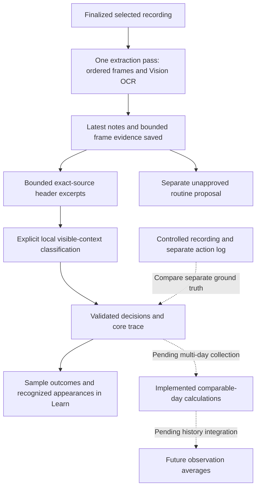

# What an observation can tell us

**Current source connects structured video extraction, optional local context classification and the latest observation in Learn. The first controlled recording and import checks passed; local model accuracy remains unverified. See [the benchmark record](OBSERVATION-BENCHMARK.md).** Multi-day observation collection is not connected to the day-window calculations yet.

The earlier pure-core slice passed all eleven focused tests in the 10 October package run: 138 checks passed overall, with two optional model tests skipped. That result does not validate the newer extraction/classifier/Store wiring. New extraction/import results, the earlier unavailable Mac model and the subsequent failed simulator recognition requests are recorded separately in the [benchmark guide](OBSERVATION-BENCHMARK.md).

MORE needs to distinguish a screen being visible from an app being opened, a gesture being issued, and a person reading something. The new trace preserves ordered evidence and produces conservative reports without turning those different events into one count.

## Current boundary

[`MediaObservationService`](../Sources/MorningApple/MediaObservationService.swift) now returns a validated [`ObservationVideoEvidence`](../Sources/MorningCore/ObservationVideoEvidence.swift) containing every requested frame before text deduplication. The store saves the latest evidence alongside its notes. Learn shows the sample count and outcomes, and **Recognize sampled screens** explicitly calls the separate on-device [`ObservationContextClassifier`](../Sources/MorningApple/ObservationContextClassifier.swift).

[`ObservationTrace`](../Sources/MorningCore/ObservationTrace.swift) and [`ObservationTraceWindowReport`](../Sources/MorningCore/ObservationTraceWindow.swift) remain pure calculations. The evidence adapter validates classification decisions before making a trace. Learn derives a visible-context sequence from it; the multi-day calculations have no collection/history UI connection yet.

The importer samples at most 24 frames from a selected video up to 31 minutes and 512 MiB. It reserves a 30,000-character/256,000-byte OCR budget so rendered notes remain within 32,000 characters. Every request remains represented when text is truncated or omitted; affected frames cannot support context identification. Invalid actual presentation times retain a labeled requested-time fallback.

The notes renderer collapses adjacent identical OCR, while structured frames retain their IDs and order. The routine-learning policy still globally deduplicates its own eligible text; context classification uses the original structured frames instead. `extractText` renders the same extraction rather than running OCR a second time. A routine proposal's planned minutes are not observed duration.

## The trace contract

Each sample has a stable ID, a relative media timestamp, an actual-presentation or requested-sampling time basis, and an outcome: observed, blank, decode failure or OCR failure. App evidence is identified with a source reference, ambiguous with a reference, or unknown. A context key is not automatically a verified bundle identifier.

The trace preserves samples in supplied chronological order. Invalid/nonfinite/out-of-range times, decreasing times, duplicate sample IDs, overlapping coverage intervals and inconsistent names for the same context key are rejected. Decoding a saved trace repeats validation. Equal timestamps are allowed: agreeing app claims form one moment; conflicting or unknown claims make that moment unresolved rather than inventing an order.

Coverage intervals mean **verified continuous captured spans**. An isolated observed frame may exist outside those spans while the surrounding duration remains unknown. Adapters must not use these intervals to mean “definitely absent media” and simultaneously supply observed frames from that absence. `nil` means continuous capture coverage is unknown; an empty array means no supported continuous span. Complete declared capture does not establish complete semantic analysis.

The adapter checks the original frame ID, exact timestamp and time basis, exact source reference and same-frame quotation. Duplicate decisions, foreign samples, altered times and citations from failed or truncated frames are rejected. Missing decisions remain unknown. The saved frame OCR resolves the reference; these checks do not establish that the proposed label is semantically correct or prove an action.

The classifier emits `visual-context:` identities. Without a catalog, a label must be a literal early OCR line accepted by a narrow lexical check. **Inbox → Alex → Inbox can occur within one app** and must not become an app-entry count. With a separately supplied catalog, leading punctuation/symbol decoration may be removed for comparison while the quote retains the original whole line. A second catalog mention blocks identification, including a competing name with alphabetic OCR damage; the validator does not repair such damage to establish an identity. These lexical rules constrain vocabulary and ambiguity, not OS-verified foreground identity. The ordinary app currently supplies no catalog. Context labels, quotes and their order are never authorization to automate anything.

Classification considers at most **24 frames**. For each eligible frame it selects an unchanged, contiguous source prefix of at most **320 Swift characters and six whole nonempty lines**. An overlong line stops selection; a later convenient header cannot jump ahead of it. Deliberate excerpt selection does not mark otherwise complete source OCR as truncated. The full bounded original frame text, ID, order and times remain intact. A proposed quote must belong to both the selected excerpt and that original frame.

Selected text is capped at 9,000 characters overall, with at most four frames and 2,000 encoded prompt characters per batch. Twenty-four 320-character excerpts fit within 7,680 characters before prompt structure/catalog overhead; the separate prompt limit can reduce a batch. Blank, failed, source-truncated, empty-excerpt or over-budget frames stay unknown. Optional `inputSelection` records the policy, source character counts, selected start/end offsets and excerpt text. Offsets use Swift characters with an exclusive end. Older saved classifications omit this metadata; its presence records preparation, not necessarily an inference attempt.

Results distinguish no eligible frames, model unavailable, completed, partial failure and failure; completed inference is not proof of correct recognition. No deterministic labeler or cloud fallback substitutes for a failed or unavailable model. On the baseline's pure replay, the refinement selected **all 24 frames and 2,217 characters**, fixing the previous input-exclusion problem. It does not show that a model can identify those frames or resolve breadcrumb ambiguity.

## Visible visits and time

| Report value | Meaning and limitation |
|---|---|
| Minimum visible visits | Ordered appearances separated by another identified context. Includes a context already visible at the start; it is not an OS app-open count. Multiple contexts can belong to one app. |
| Minimum visible returns | Subsequent visible visits to the same context after another identified context. Unseen switches may be missing. |
| Observation duration | The declared media timeline length, not the person's entire morning. |
| Captured duration | Sum of supported continuous captured spans; unknown when those spans are not declared. |
| Sampled visible seconds estimate | Sum of adjacent, same-context sample spans within the explicit maximum-gap policy and supported captured coverage. Endpoints must use actual presentation times. This is an estimate, not measured usage, reading time or a proven lower bound on duration. |
| Unassigned captured seconds | Supported captured time that the estimate did not assign. It must not be redistributed to fill the timeline. |

There are no exact swipe, scroll, read, reply, pickup or OS app-open fields. A swipe issued by a test controller and a verified list movement belong in a separate ground-truth record. Visible message text does not prove reading; sparse frames do not reveal every gesture.

For a synthetic trace with complete coverage from 0 to 10 seconds and a two-second gap limit:

| Media seconds | 0 | 2 | 4 | 6 | 8 | 10 |
|---|---|---|---|---|---|---|
| Identified context | A | A | B | B | A | A |

The report preserves **A → B → A**: A has two minimum visible visits and one return; B has one visit. Same-context spans contribute an estimated four seconds for A and two for B. Four captured seconds remain unassigned at context changes. Actual app-use time and exact app openings remain unknown.

Repeated identical A samples do not create another visit. **A → unknown → A** supports only one minimum visit and no duration across the unknown moment. First/last sample times on a visit describe observations, not a claim of uninterrupted use. A maximum-gap rule is an explicit assumption; it cannot rule out shorter unseen switches.

## Four usable days in a five-day window

`ObservationTraceDay` explicitly assigns a trace to a date, time zone and comparison key. Relative movie timestamps do not supply that calendar date. `ObservationComparisonPolicy` declares the expected window length, allowed duration difference and maximum sample gap.

These APIs are implemented, but the app currently replaces one latest observation. It does not collect four or five mornings, persist a longitudinal frame library or display these observation averages.

A comparable window must have the selected origin, matching comparison key, complete declared capture, duration within policy, at least two distinct moments, resolved context identities, actual presentation times and sample gaps within policy, including the edges. Incompatible or partial days are excluded with a reason; absent days are listed separately. Unknown origin is excluded. A different time-zone identifier, duplicate day or reuse of one trace ID on multiple scheduled days is rejected rather than silently combined.

Human and synthetic comparisons are separate: `.human` is the default origin, and an explicitly synthetic report excludes human records. A synthetic result cannot become personal morning history through this API.

For arithmetic illustration, visible-visit lower bounds `[2, 3, 1, 2, unknown]` yield a mean of **2 over 4 evidence days**, with a range of 1–3 and one day without evidence. The denominator is not five. This is an example, not a measured benchmark result.

Each metric has its own denominator. A day may support a visible visit but no same-context duration span, so the duration mean can use fewer days. An app absent from all identified moments of an eligible window contributes zero to its **minimum visible-visit count**; that does not assert zero actual app use between samples. An unavailable duration remains unknown. No usable days produce no app metrics and an unknown mean. Means of visit lower bounds remain lower bounds, and sampled-time means remain estimates.

## Latest observation and retention

The store persists the latest structured video evidence and optional classification, including available input-selection metadata, in its workspace snapshot. Header excerpts do not replace the full bounded OCR source. A successful new import replaces them. Editing the observation clears its attached frames and classification because edited prose no longer matches the original source; Clear removes notes, frames and classification. Those changes use the existing explicit/lifecycle save boundaries. Save errors retain the in-memory state and report the failure.

Classification is installed only after cancellation checks, confirmation that the same evidence ID is still current, and adapter validation. Loading saved classification repeats citation/time validation. Derived reports are recomputed from the evidence and decisions; there is no second report-history file. The pure trace stores references, while the latest `ObservationVideoEvidence` stores bounded OCR bodies and extraction metadata. No frame pixels are stored by this path.

All-blank or failed-sample video extraction returns structured diagnostics to its caller. When no readable text exists, the store **preserves the previous notes, frame evidence and classification**, reports the sample-count failure, skips routine proposal and keeps an owned raw recording for retry/discard. It does not save the blank import over the previous observation. The text-only convenience API still throws when there is no recognized text. An owned raw clip is also retained after extraction, cancellation or persistence failure; successful readable-text persistence permits its removal. Later classifier/model failure does not restore deleted raw video. User-selected originals are not deleted. Saved routine quotations can outlive clearing the latest observation. See [architecture and retention](ARCHITECTURE.md).

The app passes no trusted continuous-capture intervals when deriving this latest report, so capture duration and sampled-time estimates stay unknown even when media duration is known. A benchmark may separately declare verified host-capture intervals; controller actions are not evidence of capture coverage. If replay is needed, retain the synthetic benchmark original explicitly. There is no hidden raw recording archive.

## Controlled benchmark and remaining checks

The first native driver, movie and import/persistence checks are complete; inference accuracy, held-out cases and independent multi-day sessions remain open. The earlier Mac model attempt was unavailable with zero requests. The later simulator attempt reached recognition and reported availability, but **all six requests failed, no responses returned, and all 24 decisions stayed unknown**. Its app-process native log reported `operationNotAllowed: Simulator is not supported` in a required backend. This establishes a runtime support failure; it is neither a content-violation finding nor measured model abstention. A follow-up diagnostic UI check also failed with the same six-request/zero-response/24-unknown result. Its six sanitized native-error categories are `other`; they contain no error descriptions. The unsupported-simulator cause comes from the separate local app-process log, not from that sanitized category. No physical-device context-model benchmark has run. The complete protocol is:

1. Build two test-only native fixture apps from one small source: a scrollable synthetic inbox and calendar, with stable row identifiers and no accounts or external writes. One app with two screens can test scene changes but cannot prove cross-app entries.
2. Drive a bounded A → B → A sequence (the first run used 45 seconds of deliberate holds and took 91.870 seconds including navigation) with bounded XCTest actions and visible postconditions. Log attempted swipes separately from demonstrated row movement, and foreground activation separately from a new entry. Keep timestamps and capture-alignment uncertainty. Use actual simulator video, then finalize it before import.
3. Send only that movie through the real extraction, structured adapter and report. Verify saved evidence is visible and survives relaunch. Pass the same saved OCR to the existing routine proposer independently. Model unavailability, guard abstention, model abstention and inference failure are distinct outcomes. Never feed controller truth or expected counts into classification. Text fixtures cannot substitute for a failed movie.
4. Compare claims with the controller's separate truth, matching only equivalent metrics one-to-one. Report false positives, misses, comparable count errors, timing bounds, unknowns and both capture and sampling gaps. Show all scripted events as well as those visible in analyzed samples; scoring only visible events would hide sampling misses.
5. Hold out a reordered sequence with different synthetic text. Include a rapid visit, static screen, repeated content, no-movement swipe, ambiguous/blank frame and setup-only versus mixed activity. Injected extraction failures are fault tests, not observed OS failures. Then run four or five independent comparable synthetic windows to verify day denominators; copying one clip to several dates is not several mornings.

Choose scoring definitions and thresholds before the held-out run. Simulator video validates that development path, not the phone's ScreenCaptureKit lifecycle. The later phone trial requires the owner's explicit system approval, an unobscured fixture sequence, the ordinary finalized-recording/import flow and separate confirmation of visible evidence and model output. A pass must not be generalized to arbitrary apps, protected content, long captures, pickups or personal habit accuracy.

Raw movies, OCR, controller logs and result bundles stay local and ignored. Publish only reviewed aggregate results with source revision, scenario version, device/OS, model availability and a proceed/fix/stop decision. Related work: [observation plan](OBSERVATION-PLAN.md), [verification history](PHASE-ONE.md), [controlled benchmark #23](https://github.com/gibouu/morning-operator/issues/23).

Source checks: [trace/day tests](../Tests/MorningCoreTests/ObservationTraceTests.swift), [structured evidence/citation tests](../Tests/MorningCoreTests/ObservationVideoEvidenceTests.swift), [production extraction-assembly tests](../Tests/MorningAppleTests/StructuredVideoExtractionTests.swift), [context validation tests](../Tests/MorningAppleTests/ObservationContextClassifierTests.swift). Deterministic tests cover evidence structure, unknowns, exact citations, budgets and arithmetic; they are not movie or model evaluations. App integration: [store](../Sources/MorningOperator/MorningStore.swift), [sample review](../Sources/MorningOperator/ObservationEvidenceView.swift).
