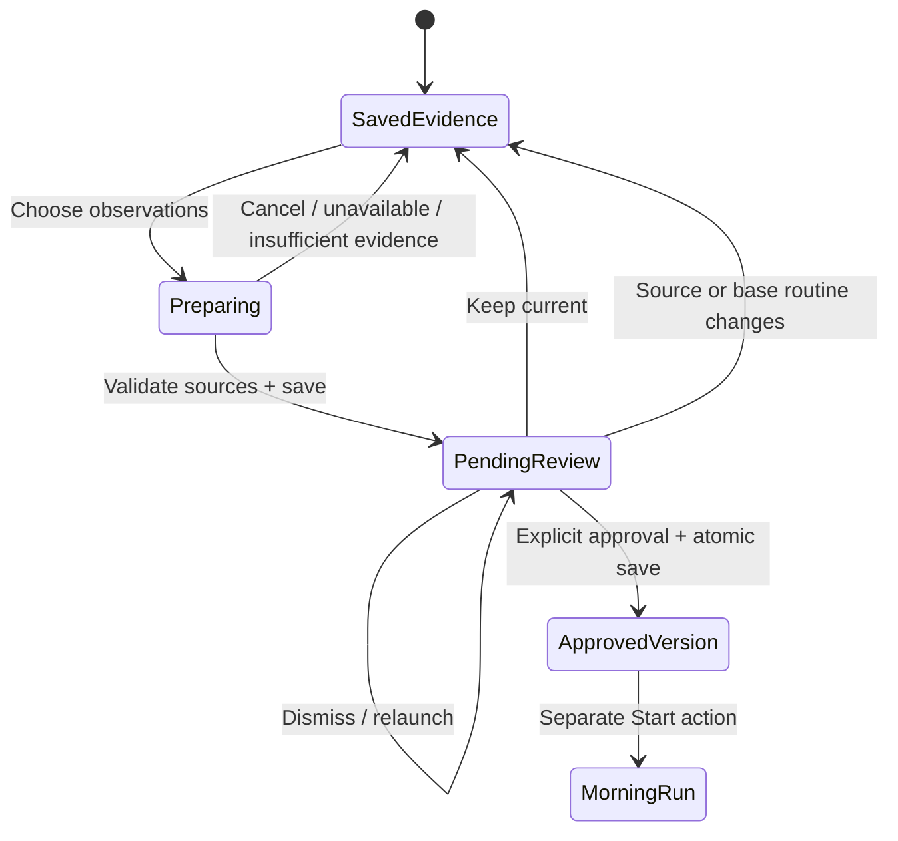

# From observations to a morning

The **Choose mornings** flow keeps the current morning usable while a proposed update is reviewed. Learning begins with explicitly saved evidence; a date on a recording does not establish a complete morning or measured phone use. The separate single-observation **Learn → Suggest a routine** path still installs an unapproved draft and offers restoration of the prior approved routine.

## The review flow

Open **Review → Saved observations → Choose mornings**. Choose one to five dated observations from the same time zone. Personal observations and synthetic samples are separate selections. An undated observation needs an assigned day; unknown or automated activity cannot silently become personal behavior.

**Suggest an update** asks the local Apple model for supported activities. The resulting sheet shows planned minutes and the observations behind each suggestion. **Done** leaves the suggestion available for later. **Keep current** discards it. **Approve update** saves the approved version for the next morning. Approval does not start playback or grant permission to control another app.

The existing routine stays unchanged during generation and review. An active or paused morning keeps its original version and blocks replacement. After approval, **Review → Your routine → Restore previous routine** can restore the previous approved version while no morning is active.

## What reaches the model

The model receives temporary source-unit identifiers, evidence type and bounded text. Acquisition identities, frame identities, dates and origins remain in an app-owned mapping. Original video evidence keeps its sampled-frame identity through that mapping. A correction replaces the model input for that observation and is labeled as a user report; it is not passed off as unmodified screen text.

```mermaid
flowchart LR
    A[Saved acquisitions] --> B[Validate dates, origins and limits]
    B --> C[Original screen units or corrected report]
    C --> D[Local Foundation Models]
    D --> E[Validate supplied unit IDs and exact quotes]
    E --> F[Preserve required user rituals]
    F --> G[Pending suggestion]
    G --> H[Explicit review and approval]
    H --> I[Next routine version]
```

The operation has an 8,000-character submitted-prompt budget, including unit identifiers, wrappers and the repeated prompt preface, and at most six model requests. Trusted instructions, schema and output are outside that character count. Oversized selections require a smaller selection rather than silently preferring the first day. Excluded visual material is disclosed; an observation with no eligible activity evidence cannot be silently counted as supporting a proposal. The final routine permits at most ten moments, including kept rituals; exceeding that limit requires a narrower selection and never silently drops a ritual.

Each inferred moment retains typed citations with acquisition identity, a source revision, source layer, exact quote, character offsets and a sampled-frame identity where applicable. The app assigns dates and origins. The model cannot invent them, approve its own output, mark a ritual required or assign an executable operation. Preserved user decisions have no new inference citations. Model requests use independent sessions; assembly merges only matching normalized titles and categories, combining their citations without computing averages.

The existing required ritual is preserved as a user decision, with its user-owned fields. It is not relabeled as a newly observed habit. Preserving every optional edit, removal and duration preference across future updates still needs a durable preference journal.

## What the dates mean

| Statement | Supported interpretation |
| --- | --- |
| “Four observations across three dates” | A description of the selected records, with same-day clips counted once in the date total. |
| A quoted calendar entry appears in a sampled frame | Visible task content; it does not prove the entry was read. |
| “I play chess after checking my calendar” in corrected notes | An explicit user report, distinct from screen evidence. |
| A proposed five-minute moment | Planned time to review, not measured app use or a duration average. |
| An app does not appear in a selected clip | Missing evidence outside the observed samples; not zero use. |

This flow does not produce a habitual frequency, complete-day average, scroll count, message-read count or probability of a preference. Comparable-window reporting has its own [coverage and denominator requirements](OBSERVATION-METRICS.md). Four partial clips do not automatically satisfy four adequate mornings.

## Durability and changes

One pending proposal is saved in the same atomic workspace as its sources and current routine. Full source and base-routine revisions are checked when generation returns, during persistence, after restoration and before approval. Changing corrected text, deleting a cited observation, changing its day/origin or changing the base routine invalidates the dependent suggestion. A late task cannot restore forgotten evidence.

Approval saves the new approved routine, previous approved version, ready session and removal of the pending proposal together. If saving fails, the previous in-memory values are restored for retry. Rejecting a proposal leaves sources, routine and saved runs intact. Unsupported saved derived proposals are discarded without making original observations or the existing morning unreadable.

Pending citations are local derived data. They are removed when the proposal is discarded, invalidated or approved. The approved routine retains its step content and embedded quotations; deleting an observation does not erase separately saved routine/history content. There is no automatic expiry, cloud upload or model training from these records. See the [retention table](ARCHITECTURE.md#data-retention-today) for other stored data.

## Verification boundary

Shared validation tests and six isolated synthetic app journeys have passing results across scoped runs for provenance, preservation, persistence, approval and compact review. The first UI run passed four checks and failed to reach an offscreen discard action. Moving both choices into a fixed footer passed the two affected journeys, and the final compact layout passed its separate visibility check. A deterministic suggestion used by a UI test is explicitly labeled and is not an Apple model result. Normal app launches never use it as a fallback.

Actual multi-observation generation and proposal quality still require a ready model on supported hardware. The latest native Mac readiness probe reported `modelNotReady`; the connected device query listed only a simulator. The existing simulator model backend rejects inference. This implementation does not turn those unavailable checks into successful learning evidence. Exact runs and failures are recorded in [PHASE-ONE](PHASE-ONE.md).

Relevant work remains in [#11 — multi-day routine versions](https://github.com/gibouu/morning-operator/issues/11), [#21 — observation analytics](https://github.com/gibouu/morning-operator/issues/21) and [#23 — controlled recording benchmark](https://github.com/gibouu/morning-operator/issues/23).
