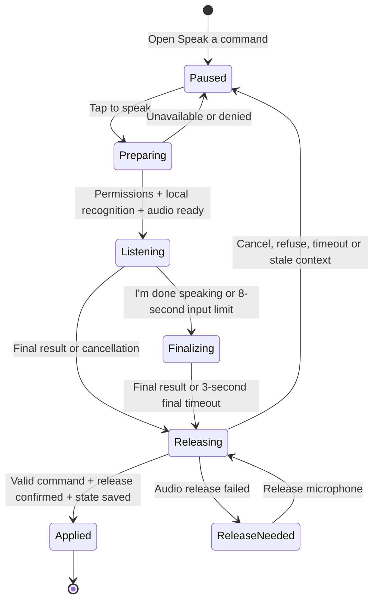

# Speak a command to MORE

**Current branch implementation; physical microphone validation pending.** The new listening flow compiles in the iPhone simulator; entry/close and touch fallback passed without requesting microphone access. Separate synthetic speech-output checks passed. This is not evidence of recognition, microphone handoff or audible output on the owner's iPhone. Earlier speech-output checks and the installed `8a640ea` baseline do not validate this new listener. See [verification history](PHASE-ONE.md) for results as they become available.

## Use it

1. Start an approved routine. Open **Morning controls → Speak a command**. MORE pauses the run and cancels its current automatic operation.
2. Choose **English** or **Français**, then **Tap to speak**. The app stops and releases its speech output before preparing the microphone. It requests Speech and microphone access when needed.
3. Wait for **Listening for one command…**, then say one command from the table below. The sheet shows the current microphone route and a temporary transcript. You may say “MORE next” or “MORE suivant”; MORE is an optional prefix during this turn, not a background wake word.
4. Tap **I'm done speaking** to finish input early, or let the eight-second input limit finish it. MORE waits for a final recognition result, releases the microphone, checks that the same routine step is still active, then applies one accepted command.

**Close cancels listening and leaves the morning paused.** “I'm done speaking” allows a final command to be accepted. Saying **stop**, or choosing **End morning** in Morning controls, ends the routine. A canceled or refused turn does not resume the routine automatically; close the sheet and use the ordinary routine controls.

## Supported commands

These are exact phrases after normalization of case, accents and punctuation. The language picker configures recognition for `en-US` or `fr-FR`; the parser accepts the listed English and French phrases. One optional leading “MORE” is allowed.

| Command | English phrases | French phrases | Effect |
|---|---|---|---|
| Next | next; next step | suivant; étape suivante | Mark the current step complete and advance once. Resume the run if another step remains; the last step completes the run. |
| Pause | pause; pause morning | pause; mets en pause | Keep the run paused. |
| Resume | resume; continue; resume morning | reprends; reprendre; continuer | Resume the current step using its existing supported operation, if enabled. |
| Skip | skip; skip step; skip this step | passe cette étape; passer cette étape | Mark the current step skipped and advance once. Resume if another step remains. |
| Repeat | repeat; repeat that; repeat this step | répète; répéter; répète cette étape | Read the current step's title and detail aloud; keep the run paused. |
| Stop | stop; stop morning | arrête; arrêter; arrête la routine | End the run. This is different from canceling the microphone turn. |

This is a command grammar, not conversational intent inference. “Don't go next”, “next and stop”, “send a message” and “MORE” alone are refused when recognized as those phrases. Partial transcripts never dispatch actions. The first final result is considered once; every supplied recognition alternative must resolve to the same command. Recognition can still mishear a person: the grammar does not authenticate a speaker or identify recorded speech.

## A single listening turn

The eight-second limit starts when audio capture starts. After input ends, the recognizer has up to three more seconds to return a final result. Permission dialogs, setup and audio cleanup are outside those limits, so eleven seconds is not a total-turn guarantee. A final result may arrive earlier.

Opening the sheet pauses first. Before listening, the store awaits speech-output shutdown. It blocks playback and overlapping turns while input is preparing, active, finalizing or still owns the audio session. After input finishes, it releases that session before returning a command. An unresolved release shows **Release microphone**; that button retries cleanup, not recognition. The run stays paused while release is unresolved.

An actual microphone-input route change while listening, an audio interruption, app backgrounding or closing the sheet cancels the turn. Late callbacks cannot apply a canceled turn. An accepted command is pinned to a session, routine version and step, and its turn ID prevents duplicate application. The resulting session state is saved before resumed speech or automatic work is dispatched. This does not add new cross-app automation capabilities.

## Processing and privacy

The listener uses Apple's Speech framework and an in-memory `AVAudioEngine` input stream. It requires both a recognizer that reports on-device support and `requiresOnDeviceRecognition = true`. If the language or local recognizer is unavailable, MORE refuses listening and offers touch controls; it does not fall back to server recognition. [Apple: on-device support](https://developer.apple.com/documentation/speech/sfspeechrecognizer/supportsondevicerecognition), [requiring on-device recognition](https://developer.apple.com/documentation/speech/sfspeechrecognitionrequest/requiresondevicerecognition).

The app writes no microphone audio file or command transcript to its workspace, exports or learning history. The transient transcript may remain visible in memory until a new turn or the app's lifetime ends. Only the resulting ordinary routine state/events are saved. Voice commands do not become habit-training examples, and this flow makes no model-training request.

Speech and microphone permission are requested by the explicit listening action, not by opening Morning. Denial or unavailable recognition leaves touch controls usable. Microphone permission belongs to Apple's app-level audio permission flow; recognition availability can vary by device and language. [Apple: microphone permission](https://developer.apple.com/documentation/avfaudio/avaudioapplication/requestrecordpermission(completionhandler:)), [recognizer availability](https://developer.apple.com/documentation/speech/sfspeechrecognizer/isavailable).

The listener observes Apple's audio route and interruption notifications to cancel input safely. This implementation uses `SFSpeechRecognizer`; it does not yet use `SpeechAnalyzer`. [Apple: route changes](https://developer.apple.com/documentation/avfaudio/avaudiosession/routechangenotification), [audio interruptions](https://developer.apple.com/documentation/avfaudio/avaudiosession/interruptionnotification).

## Physical-phone acceptance script

**All listener checks below are pending until recorded against a named installed build.** Use an approved synthetic routine with three harmless manual steps, no external writes and automatic read-aloud initially off. Record source revision, iPhone/iOS, selected language, microphone route and actual outcomes. Do not treat a simulator build, injected transcript, unit test or TTS completion callback as a microphone pass.

| Check | Procedure and required outcome |
|---|---|
| Entry and consent | Start the synthetic routine, open Morning controls → Speak a command, and verify the run pauses. No microphone turn starts until Tap to speak. On a fresh permission state, observe the system prompts. Test denial separately: no advance or speech, a clear fallback, and ordinary buttons still work. |
| One command | Select English, tap, wait for Listening, say “next”, then tap I'm done speaking. Confirm exactly one completion and the next step. Restart a clean synthetic run and repeat for each command; verify skip versus complete, repeat while paused, and stop as a terminal state. |
| French and prefix | Select Français and exercise the displayed French commands. Test “MORE suivant” during an active turn. Saying MORE before tapping must not start a turn; saying MORE alone during a turn must not run a command. |
| Refusal | In separate turns say “don't go next”, “next and stop” and “send a message”. Confirm the recognized text and no routine action. If recognition changes the words into an allowed command, record a recognition failure, not a successful refusal. Pause after “next” within a longer sentence and verify no partial result advances the routine. |
| Silence and cancellation | Stay silent: capture ends at its limit and no command is applied without a valid final result. Close during preparation, listening and finalization; wait beyond the final timeout and confirm no late action. Contrast this with I'm done speaking, which may accept the final command. |
| Permissions and offline capability | Test denied Speech access and denied microphone access independently, then restore access. With the required local language support available, test an offline turn. If on-device support is absent, the expected outcome is refusal and touch fallback, never a server fallback. |
| Audio handoff | Start reading a harmless step aloud, then open the voice sheet and tap to speak. Output must stop before microphone capture; it must not recognize its own spoken step as a command. After a successful repeat, verify microphone release and ask a human listener to confirm the actual audio. |
| Route and lifecycle | During listening, change the actual microphone route, background the app, and cause an audio interruption in separate trials. Each must cancel without a late command. Return and verify a new explicit turn works; if release fails, playback remains blocked until cleanup succeeds. |
| Repeated controls | Tap finish or cancel repeatedly during one turn. There must be no duplicate step completion, overlapping listener or stale result applied to a later step. Context and duplicate guards also need their deterministic regression tests. |
| Cancel versus end | Close a listening turn and verify the run remains paused and resumable. Separately say “stop”, and separately choose End morning: each must end the run, not merely hide the sheet. |

Keep any diagnostic transcripts synthetic and any device artifacts private. Log pass, failure and unavailable/skipped checks separately. A supported-command demonstration does not establish general conversational accuracy, speaker authentication or reliable use in noisy rooms.

## Still ahead

Always-listening MORE detection, conversational interruptions, free-form dialogue, microphone-driven thought capture, prepared/cached morning recaps, and HomePod microphone input remain future work. The existing Siri capture entry and spoken-output voice chooser are separate features. A future prepared recap needs connected source data, source timestamps and freshness rules; hearing a command does not grant access to messages, health data or another app's interface.

Implementation: [voice sheet](../Sources/MorningOperator/MorningVoiceCommandView.swift), [store orchestration](../Sources/MorningOperator/MorningStore.swift), [listener](../Sources/MorningApple/MorningVoiceCommandListener.swift), [strict grammar and turn guards](../Sources/MorningCore/MorningVoiceCommand.swift). Related work: [voice #4](https://github.com/gibouu/morning-operator/issues/4), [V2 #25](https://github.com/gibouu/morning-operator/issues/25).
